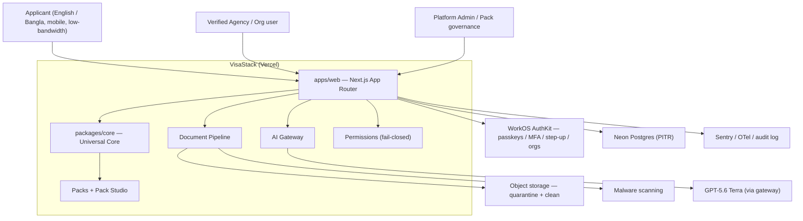

# Architecture Overview

> This overview is reconstructed from the PRD Coverage Audit v1.1 and will
> be reconciled clause-by-clause against the 3-page PRD and Build
> Specification as they are imported. Where they disagree, they win.

## System context

## Layering (dependencies point inward)

1. **Universal Core** (`packages/core`) — pure domain: entities, value
   objects, `Result`, branded IDs, and the rules that never change when the
   framework or a provider changes. Imports nothing framework/infra.
2. **Domain packages** — `packs`, `permissions`, `pipeline` express
   VisaStack-specific behavior in terms of Core.
3. **Infrastructure adapters** — `auth`, `db`, `storage`, `ai-gateway`,
   `crypto`, `observability` wrap external providers behind interfaces.
4. **Application** (`apps/web`) — Next.js UI + API composes the above. It
   is the only layer that knows about HTTP, React, and Vercel.

The rule: **an inner layer never imports an outer one.** This is what makes
the platform upgradeable — swap a provider or the framework without
touching domain rules.

## Core domain concepts (from the audit)

- **Universal Core + Packs.** A generic engine plus versioned, cited,
  admin-approved requirement packs authored in **Pack Studio**.
- **Mission Workspaces.** Parallel applications, each pinned to an
  **immutable snapshot** of the pack/application it was judged against.
- **Field proposals.** No record mutates silently; every AI or human
  proposal is versioned, deduplicated, and **atomically approved**.
- **Document pipeline.** upload → quarantine → malware scan → clean →
  process → extract, with recoverable failures at every step.
- **AI Gateway.** Privacy, cost caps, caching, evaluation, outage handling,
  and escalation around GPT-5.6 Terra.
- **Permissions.** Separate rights for preview / original / redacted /
  pack / export; deny-by-default; audited even on denial.
- **Consent & lifecycle.** Consent separation, a no-AI manual path,
  export, deletion, retention, and legal-hold handling.

## Cross-cutting requirements

- **Security:** passkeys/MFA/step-up, session revocation, KMS envelope
  encryption, secret rotation, no sensitive browser/PWA cache, no
  sensitive email attachments, no production data in test.
- **Reliability:** availability and RPO/RTO targets, restore drills,
  incident response, graceful degradation.
- **i18n / a11y:** English + Bangla, WCAG 2.2 AA, international formatting,
  low-bandwidth and mobile.
- **Release gates:** benchmark thresholds, the no-silent-mutation gate, and
  an external penetration test before release.

## Out of current scope

Employer, law-firm, forms, and marketplace functionality are explicitly
future scope and are not built in the launch.
