# VisaStack localization review packet: 20 user journeys

Status: DRAFT FOR REVIEW. Nothing here is released text. The Bengali on the screenshots is a model draft swapped into exact-match text on real rendered screens; it has no human sign-off.

How to read a journey: each has phone screenshots in three forms, the automated checks that apply, the key strings with their draft Bengali, and an empty sign-off block for the human reviewer.

- **English**: the real screen as the product draws it today, against made-up data.
- **bn-BD draft**: exact-match strings replaced by the register draft. Strings that contain numbers, names or links are not swapped, so these screens are mixed. The swap rate is printed under each image set.
- **RTL probe**: the same English screen mirrored with a right-to-left direction. It tests layout only (mirroring, overflow, clipped text). It is not a translation and not an Arabic draft; no right-to-left language is enabled or justified yet.

Not covered by pictures: screens that need a one-time link or stored requests (journey J16), loading and offline states, server-side validation errors after a button press, emails, PDFs and downloads. Those are listed per journey as untested.

| Journey | Role | Screens shown | Source-only parts |
|---|---|---|---|
| J01 | visitor | 2 of 6 | none |
| J02 | visitor | 2 of 3 | none |
| J03 | visitor | 2 of 4 | none |
| J04 | traveller | 2 of 4 | none |
| J05 | traveller | 2 of 4 | none |
| J06 | traveller | 2 of 3 | none |
| J07 | traveller | 2 of 3 | none |
| J08 | traveller | 2 of 4 | none |
| J09 | traveller | 2 of 3 | none |
| J10 | traveller | 2 of 2 | none |
| J11 | traveller | 2 of 3 | none |
| J12 | invitee | 2 of 5 | none |
| J13 | agency | 2 of 4 | none |
| J14 | agency | 2 of 6 | none |
| J15 | traveller | 2 of 2 | none |
| J16 | guest | 0 of 0 | none |
| J17 | family_guardian | 2 of 4 | none |
| J18 | traveller | 2 of 3 | none |
| J19 | traveller | 2 of 4 | none |
| J20 | visitor | 2 of 4 | 1 screens not rendered |

## J01. Visitor reads the home page and the trust information

- Role: visitor
- States in this journey: populated, public, no sign-in
- Semantic checks to apply: G9 claim strength: no stronger promise than English; official-source wording on trust pages

### Screen: public__home

| English | bn-BD draft | RTL probe |
|---|---|---|
| 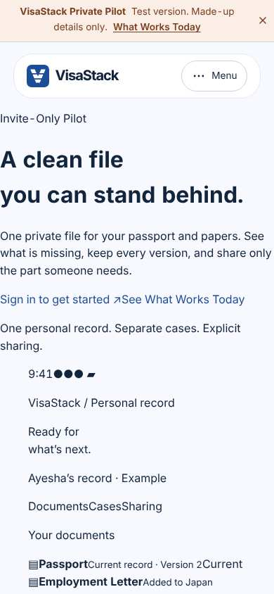 | 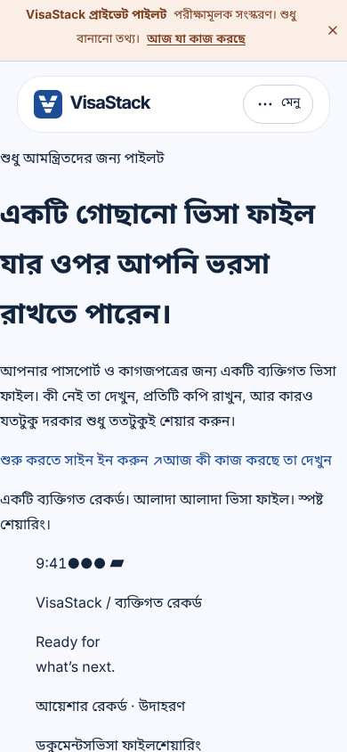 | 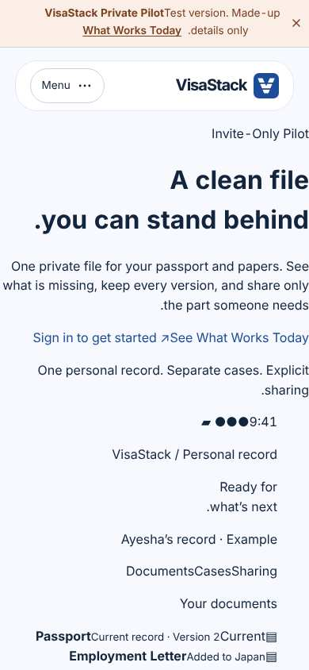 |

Measured: bn draft swapped 144 of 161 text runs (89%). Sideways overflow in pixels: English 0, bn 0, RTL 0. Clipped text blocks: English 0, bn 0, RTL 0.

| English on screen | bn-BD draft | Guardrail tags | Automated check |
|---|---|---|---|
| Test version. Made-up details only. | পরীক্ষামূলক সংস্করণ। শুধু বানানো তথ্য। | G6_copy_version | PASS |
| Invite-Only Pilot | শুধু আমন্ত্রিতদের জন্য পাইলট | G5_share_lifecycle | PASS |
| One personal record. Separate cases. Explicit sharing. | একটি ব্যক্তিগত রেকর্ড। আলাদা আলাদা ভিসা ফাইল। স্পষ্ট শেয়ারিং। | G8_data_action | PASS |
| Ready for |  | G1_state_word | no draft |
| Sharing | শেয়ারিং | G8_data_action | PASS |
| Current record · Version 2 | বর্তমান রেকর্ড · সংস্করণ ২ | G6_copy_version | PASS |
| Newer copy requested | আরও নতুন কপি চাওয়া হয়েছে | G6_copy_version | PASS |
| ◯ Sharing | ◯ শেয়ারিং | G8_data_action | PASS |
| Previous Version Kept | আগের কপি রাখা হয়েছে | G6_copy_version | VERSION_CONCEPT_REVIEW: English says version; Bengali dropped it. Fine for a document copy, wrong for a snapshot, pack or product version: editor to confirm |
| Access Ends 30 November | ৩০ নভেম্বর অ্যাক্সেস শেষ হবে | G5_share_lifecycle | PASS |

### Screen: public__trust

| English | bn-BD draft | RTL probe |
|---|---|---|
| 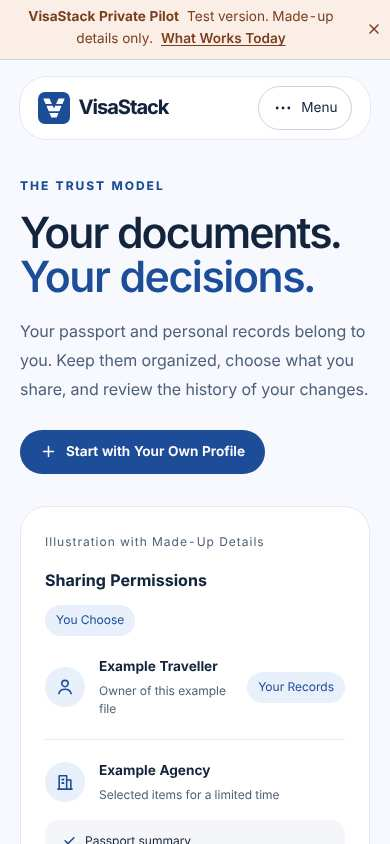 | 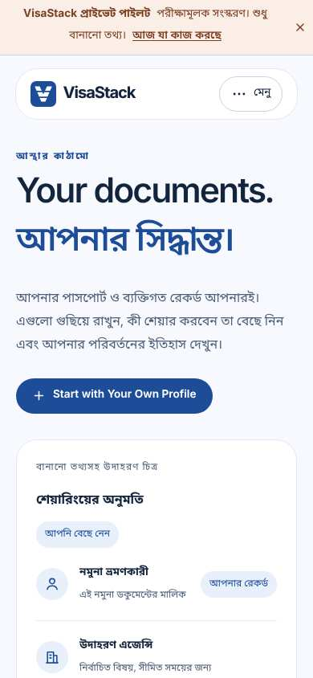 | 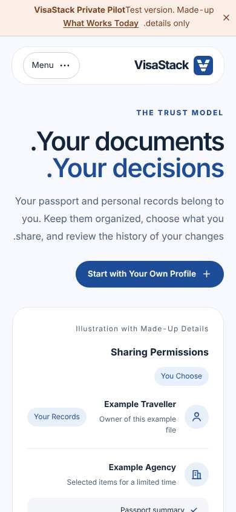 |

Measured: bn draft swapped 43 of 54 text runs (80%). Sideways overflow in pixels: English 0, bn 0, RTL 0. Clipped text blocks: English 0, bn 0, RTL 0.

| English on screen | bn-BD draft | Guardrail tags | Automated check |
|---|---|---|---|
| Test version. Made-up details only. | পরীক্ষামূলক সংস্করণ। শুধু বানানো তথ্য। | G6_copy_version | PASS |
| Sharing Permissions | শেয়ারিংয়ের অনুমতি | G8_data_action | PASS |
| Confirmed itinerary |  | G1_state_word | no draft |
| Original files stay protected |  | G8_data_action | no draft |
| Review, pause or end future access in your sharing page. | আপনার শেয়ারিং পাতায় ভবিষ্যতের অ্যাক্সেস পর্যালোচনা, স্থগিত বা শেষ করুন। | G8_data_action | PASS |
| About This Version | এই কপি সম্পর্কে | G6_copy_version | VERSION_CONCEPT_REVIEW: English says version; Bengali dropped it. Fine for a document copy, wrong for a snapshot, pack or product version: editor to confirm |
| Skip to Content | মূল বিষয়বস্তুতে যান |  | PASS |
| VisaStack Private Pilot | VisaStack প্রাইভেট পাইলট |  | PASS |
| What Works Today | আজ যা কাজ করছে |  | PASS |
| VisaStack |  |  |  |

Human review sign-off (to be completed by the editor and, for legal wording, a qualified reviewer):

| Check | Result | Reviewer | Date |
|---|---|---|---|
| Meaning matches English | PENDING | | |
| Natural bn-BD wording | PENDING | | |
| Narrow phone fit | PENDING | | |
| Screen reader names | PENDING | | |

## J02. Visitor creates an account and confirms the email address

- Role: visitor
- States in this journey: form, validation, pending verification
- Semantic checks to apply: Verified applies to the email address only

### Screen: public__auth_sign-up

| English | bn-BD draft | RTL probe |
|---|---|---|
| 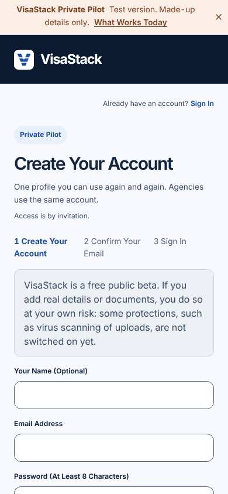 | 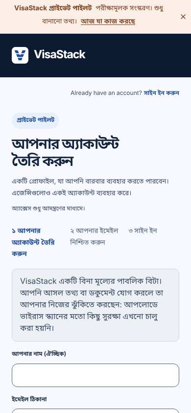 | 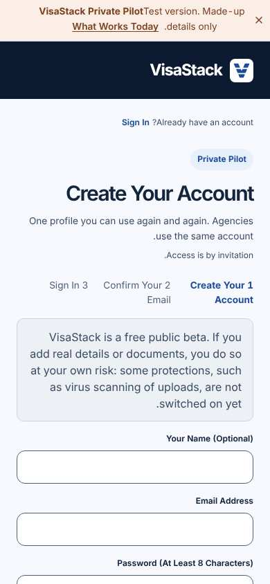 |

Measured: bn draft swapped 44 of 51 text runs (86%). Sideways overflow in pixels: English 0, bn 0, RTL 0. Clipped text blocks: English 0, bn 0, RTL 0.

| English on screen | bn-BD draft | Guardrail tags | Automated check |
|---|---|---|---|
| Test version. Made-up details only. | পরীক্ষামূলক সংস্করণ। শুধু বানানো তথ্য। | G6_copy_version | PASS |
| Keep your details together. Reuse what you need, and choose what you share. | আপনার তথ্য এক জায়গায় রাখুন। যা দরকার আবার ব্যবহার করুন, আর কী শেয়ার করবেন তা আপনিই ঠিক করুন। | G8_data_action | PASS |
| Access is by invitation. | অ্যাক্সেস শুধু আমন্ত্রণের মাধ্যমে। | G5_share_lifecycle | PASS |
| Your Name (Optional) | আপনার নাম (ঐচ্ছিক) | G3_requirement_level | PASS |
| This acknowledgement does not enable marketing, AI processing or sharing with an agency. | এই স্বীকৃতি মার্কেটিং, এআই দিয়ে প্রক্রিয়াকরণ বা এজেন্সির সঙ্গে শেয়ার করার অনুমতি দেয় না। | G8_data_action | PASS |
| We will email you a link to confirm your address before you can sign in. | সাইন ইন করার আগে আপনার ঠিকানা নিশ্চিত করতে আমরা আপনাকে একটি লিংক ইমেইল করব। | G5_share_lifecycle | PASS |
| About This Version | এই কপি সম্পর্কে | G6_copy_version | VERSION_CONCEPT_REVIEW: English says version; Bengali dropped it. Fine for a document copy, wrong for a snapshot, pack or product version: editor to confirm |
| Skip to Content | মূল বিষয়বস্তুতে যান |  | PASS |
| VisaStack Private Pilot | VisaStack প্রাইভেট পাইলট |  | PASS |
| What Works Today | আজ যা কাজ করছে |  | PASS |

### Screen: public__auth_verify-email

| English | bn-BD draft | RTL probe |
|---|---|---|
| 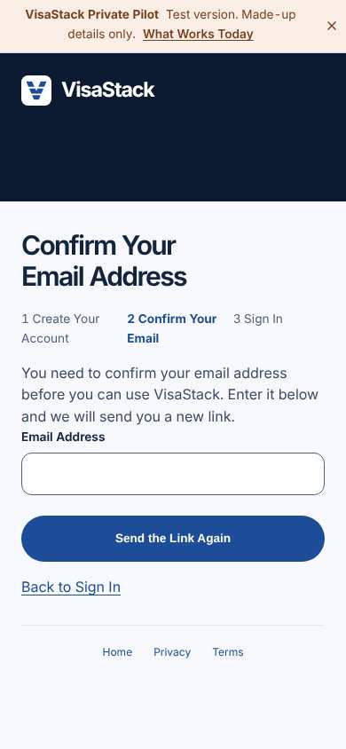 | 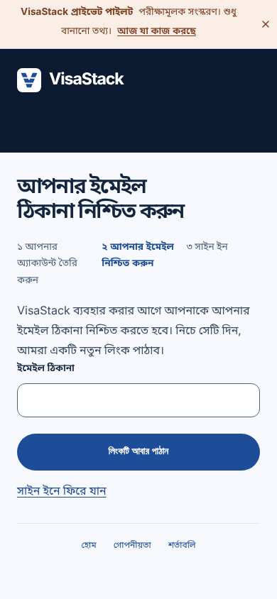 | 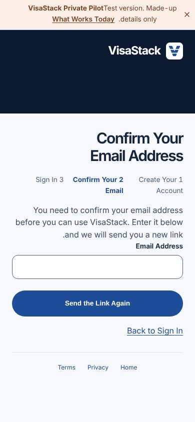 |

Measured: bn draft swapped 34 of 38 text runs (89%). Sideways overflow in pixels: English 0, bn 0, RTL 0. Clipped text blocks: English 0, bn 0, RTL 0.

| English on screen | bn-BD draft | Guardrail tags | Automated check |
|---|---|---|---|
| Test version. Made-up details only. | পরীক্ষামূলক সংস্করণ। শুধু বানানো তথ্য। | G6_copy_version | PASS |
| Keep your details together. Reuse what you need, and choose what you share. | আপনার তথ্য এক জায়গায় রাখুন। যা দরকার আবার ব্যবহার করুন, আর কী শেয়ার করবেন তা আপনিই ঠিক করুন। | G8_data_action | PASS |
| Send the Link Again | লিংকটি আবার পাঠান | G5_share_lifecycle | PASS |
| About This Version | এই কপি সম্পর্কে | G6_copy_version | VERSION_CONCEPT_REVIEW: English says version; Bengali dropped it. Fine for a document copy, wrong for a snapshot, pack or product version: editor to confirm |
| Skip to Content | মূল বিষয়বস্তুতে যান |  | PASS |
| VisaStack Private Pilot | VisaStack প্রাইভেট পাইলট |  | PASS |
| What Works Today | আজ যা কাজ করছে |  | PASS |
| VisaStack |  |  |  |
| Menu | মেনু |  | PASS |
| Product | প্রোডাক্ট |  | PASS |

Human review sign-off (to be completed by the editor and, for legal wording, a qualified reviewer):

| Check | Result | Reviewer | Date |
|---|---|---|---|
| Meaning matches English | PENDING | | |
| Natural bn-BD wording | PENDING | | |
| Narrow phone fit | PENDING | | |
| Screen reader names | PENDING | | |

## J03. Forgotten password and sign-in recovery

- Role: visitor
- States in this journey: form, sent, expired link, re-authentication
- Semantic checks to apply: expired link wording; Sent is not Received

### Screen: public__auth_forgot-password

| English | bn-BD draft | RTL probe |
|---|---|---|
| 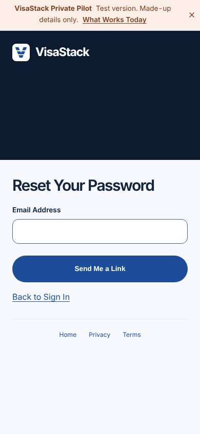 | 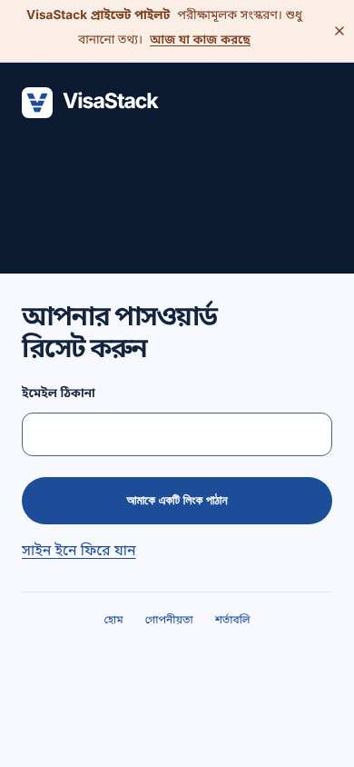 | 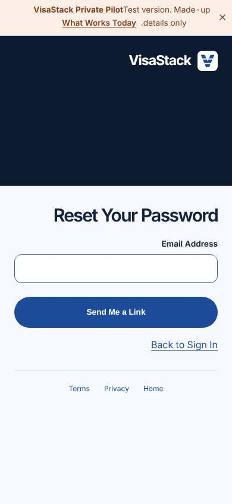 |

Measured: bn draft swapped 30 of 34 text runs (88%). Sideways overflow in pixels: English 0, bn 0, RTL 0. Clipped text blocks: English 0, bn 0, RTL 0.

| English on screen | bn-BD draft | Guardrail tags | Automated check |
|---|---|---|---|
| Test version. Made-up details only. | পরীক্ষামূলক সংস্করণ। শুধু বানানো তথ্য। | G6_copy_version | PASS |
| Keep your details together. Reuse what you need, and choose what you share. | আপনার তথ্য এক জায়গায় রাখুন। যা দরকার আবার ব্যবহার করুন, আর কী শেয়ার করবেন তা আপনিই ঠিক করুন। | G8_data_action | PASS |
| Send Me a Link | আমাকে একটি লিংক পাঠান | G5_share_lifecycle | PASS |
| About This Version | এই কপি সম্পর্কে | G6_copy_version | VERSION_CONCEPT_REVIEW: English says version; Bengali dropped it. Fine for a document copy, wrong for a snapshot, pack or product version: editor to confirm |
| Skip to Content | মূল বিষয়বস্তুতে যান |  | PASS |
| VisaStack Private Pilot | VisaStack প্রাইভেট পাইলট |  | PASS |
| What Works Today | আজ যা কাজ করছে |  | PASS |
| VisaStack |  |  |  |
| Menu | মেনু |  | PASS |
| Product | প্রোডাক্ট |  | PASS |

### Screen: public__auth_reset-password

| English | bn-BD draft | RTL probe |
|---|---|---|
| 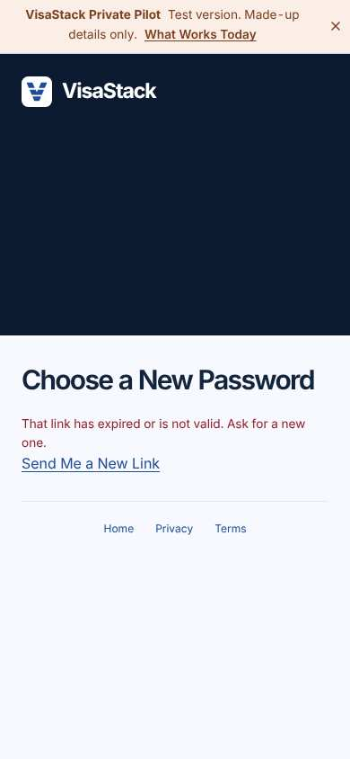 | 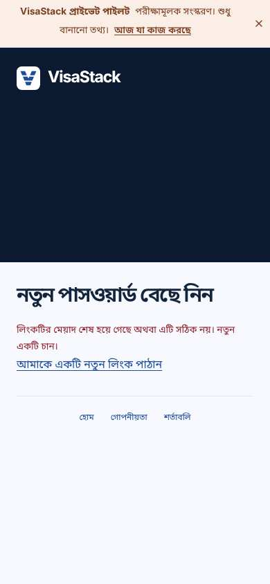 | 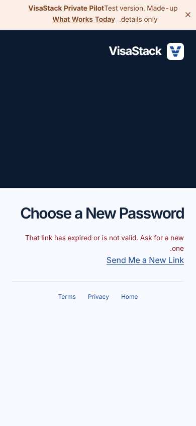 |

Measured: bn draft swapped 29 of 33 text runs (88%). Sideways overflow in pixels: English 0, bn 0, RTL 0. Clipped text blocks: English 0, bn 0, RTL 0.

| English on screen | bn-BD draft | Guardrail tags | Automated check |
|---|---|---|---|
| Test version. Made-up details only. | পরীক্ষামূলক সংস্করণ। শুধু বানানো তথ্য। | G6_copy_version | PASS |
| Keep your details together. Reuse what you need, and choose what you share. | আপনার তথ্য এক জায়গায় রাখুন। যা দরকার আবার ব্যবহার করুন, আর কী শেয়ার করবেন তা আপনিই ঠিক করুন। | G8_data_action | PASS |
| That link has expired or is not valid. Ask for a new one. | লিংকটির মেয়াদ শেষ হয়ে গেছে অথবা এটি সঠিক নয়। নতুন একটি চান। | G5_share_lifecycle | PASS |
| Send Me a New Link | আমাকে একটি নতুন লিংক পাঠান | G5_share_lifecycle | PASS |
| About This Version | এই কপি সম্পর্কে | G6_copy_version | VERSION_CONCEPT_REVIEW: English says version; Bengali dropped it. Fine for a document copy, wrong for a snapshot, pack or product version: editor to confirm |
| Skip to Content | মূল বিষয়বস্তুতে যান |  | PASS |
| VisaStack Private Pilot | VisaStack প্রাইভেট পাইলট |  | PASS |
| What Works Today | আজ যা কাজ করছে |  | PASS |
| VisaStack |  |  |  |
| Menu | মেনু |  | PASS |

Human review sign-off (to be completed by the editor and, for legal wording, a qualified reviewer):

| Check | Result | Reviewer | Date |
|---|---|---|---|
| Meaning matches English | PENDING | | |
| Natural bn-BD wording | PENDING | | |
| Narrow phone fit | PENDING | | |
| Screen reader names | PENDING | | |

## J04. First day: nothing yet, and consent not yet given

- Role: traveller
- States in this journey: empty, consent required
- Semantic checks to apply: consent wording needs qualified legal review; empty-state tone

### Screen: imran__app__home___no-consent-yet

| English | bn-BD draft | RTL probe |
|---|---|---|
| 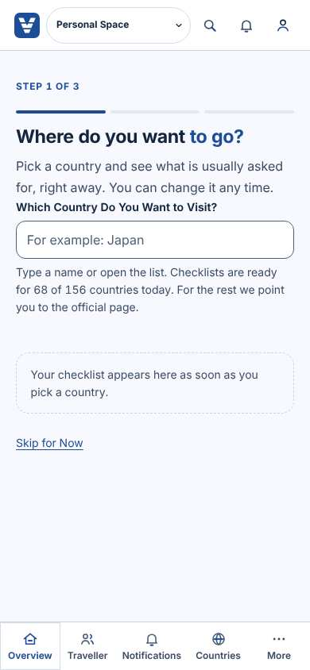 | 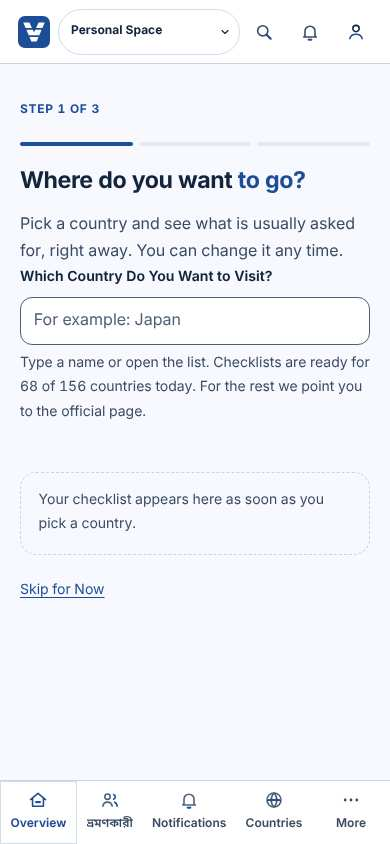 | 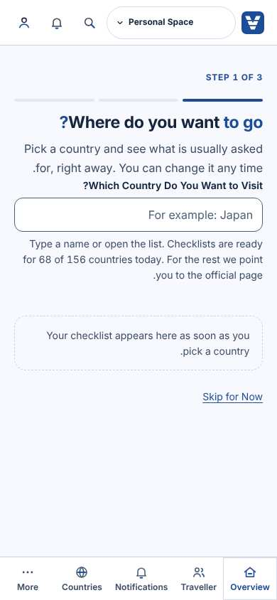 |

Measured: bn draft swapped 61 of 75 text runs (81%). Sideways overflow in pixels: English 0, bn 0, RTL 0. Clipped text blocks: English 2, bn 2, RTL 2.

| English on screen | bn-BD draft | Guardrail tags | Automated check |
|---|---|---|---|
| Sharing follows your saved permissions. | শেয়ারিং আপনার সংরক্ষিত অনুমতি অনুসারে চলে। | G1_state_word, G8_data_action | PASS |
| About This Version | এই কপি সম্পর্কে | G6_copy_version | VERSION_CONCEPT_REVIEW: English says version; Bengali dropped it. Fine for a document copy, wrong for a snapshot, pack or product version: editor to confirm |
| Skip to Content | মূল বিষয়বস্তুতে যান |  | PASS |
| VisaStack |  |  |  |
| Menu | মেনু |  | PASS |
| Product | প্রোডাক্ট |  | PASS |
| For Agencies | এজেন্সির জন্য |  | PASS |
| Privacy and Control | গোপনীয়তা ও নিয়ন্ত্রণ |  | PASS |
| How It Works | এটি যেভাবে কাজ করে |  | PASS |
| Workspace | ওয়ার্কস্পেস |  | PASS |

### Screen: imran__app_applicants__no-consent-yet

| English | bn-BD draft | RTL probe |
|---|---|---|
| 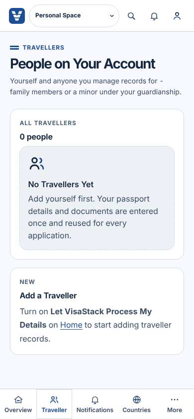 | 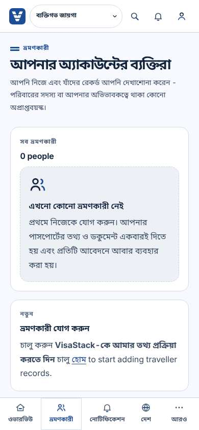 | 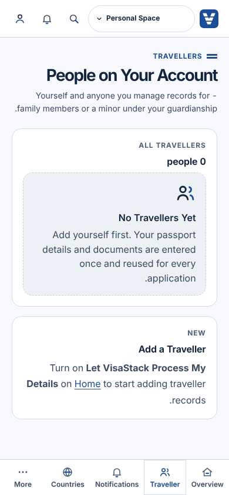 |

Measured: bn draft swapped 68 of 81 text runs (84%). Sideways overflow in pixels: English 0, bn 0, RTL 0. Clipped text blocks: English 2, bn 2, RTL 2.

| English on screen | bn-BD draft | Guardrail tags | Automated check |
|---|---|---|---|
| Sharing follows your saved permissions. | শেয়ারিং আপনার সংরক্ষিত অনুমতি অনুসারে চলে। | G1_state_word, G8_data_action | PASS |
| About This Version | এই কপি সম্পর্কে | G6_copy_version | VERSION_CONCEPT_REVIEW: English says version; Bengali dropped it. Fine for a document copy, wrong for a snapshot, pack or product version: editor to confirm |
| Skip to Content | মূল বিষয়বস্তুতে যান |  | PASS |
| VisaStack |  |  |  |
| Menu | মেনু |  | PASS |
| Product | প্রোডাক্ট |  | PASS |
| For Agencies | এজেন্সির জন্য |  | PASS |
| Privacy and Control | গোপনীয়তা ও নিয়ন্ত্রণ |  | PASS |
| How It Works | এটি যেভাবে কাজ করে |  | PASS |
| Workspace | ওয়ার্কস্পেস |  | PASS |

Human review sign-off (to be completed by the editor and, for legal wording, a qualified reviewer):

| Check | Result | Reviewer | Date |
|---|---|---|---|
| Meaning matches English | PENDING | | |
| Natural bn-BD wording | PENDING | | |
| Narrow phone fit | PENDING | | |
| Screen reader names | PENDING | | |

## J05. Traveller home and profile review

- Role: traveller
- States in this journey: populated, saved, long name, Bengali name
- Semantic checks to apply: Saved is not Submitted; bidi names and numbers

### Screen: rahim__app__home_

| English | bn-BD draft | RTL probe |
|---|---|---|
| 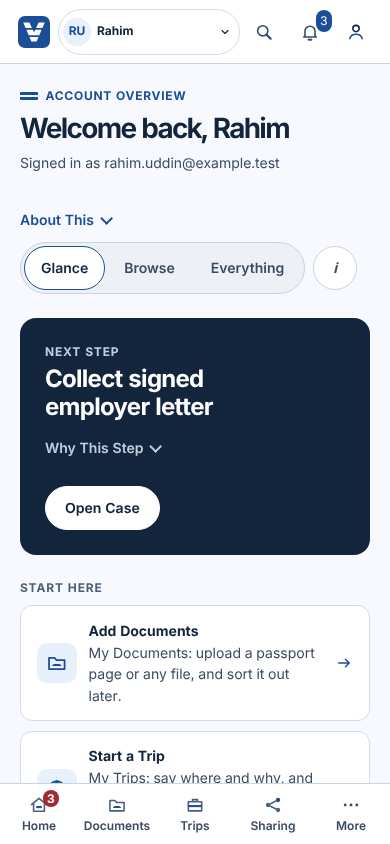 | 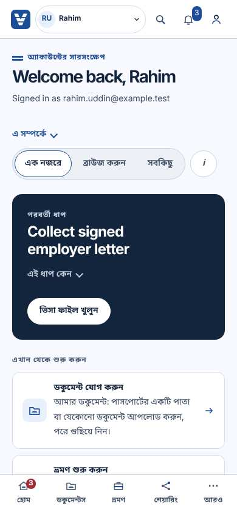 | 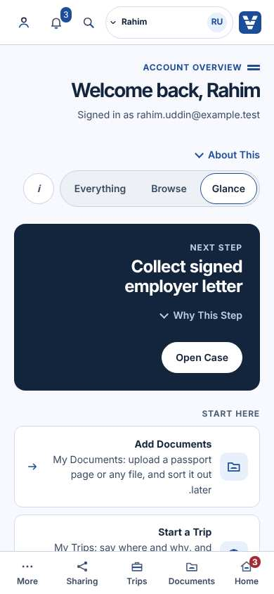 |

Measured: bn draft swapped 171 of 278 text runs (62%). Sideways overflow in pixels: English 0, bn 0, RTL 0. Clipped text blocks: English 5, bn 5, RTL 5.

| English on screen | bn-BD draft | Guardrail tags | Automated check |
|---|---|---|---|
| Sharing & Requests | শেয়ারিং ও অনুরোধ | G8_data_action | PASS |
| Sharing | শেয়ারিং | G8_data_action | PASS |
| Sharing follows your saved permissions. | শেয়ারিং আপনার সংরক্ষিত অনুমতি অনুসারে চলে। | G1_state_word, G8_data_action | PASS |
| Sent Back for a Fix | ঠিক করার জন্য ফেরত পাঠানো হয়েছে | G1_state_word | PASS |
| The agency looked at what you sent and asked for a new one. | আপনি যা পাঠিয়েছেন এজেন্সি তা দেখেছে এবং একটি নতুন কপি চেয়েছে। | G1_state_word | PASS |
| Sharing Invitations Waiting for Your Answer | আপনার উত্তরের অপেক্ষায় থাকা শেয়ারিংয়ের আমন্ত্রণ | G8_data_action | PASS |
| Someone wants to share their information with you. Nothing is shared until you accept. | কেউ আপনার সঙ্গে তাঁর তথ্য শেয়ার করতে চান। আপনি গ্রহণ না করা পর্যন্ত কিছুই শেয়ার করা হয় না। | G5_share_lifecycle, G8_data_action | PASS |
| Pick a checklist to see what is ready | কী প্রস্তুত তা দেখতে একটি চেকলিস্ট বেছে নিন | G1_state_word | PASS |
| Sends scan pictures, not just text, to an AI. | শুধু লেখা নয়, স্ক্যানের ছবিও একটি এআই-তে পাঠায়। | G2_safety_check | PASS |
| Let Me Share with Others | আমাকে অন্যদের সঙ্গে শেয়ার করতে দিন | G8_data_action | PASS |

### Screen: rahim__app_applicant__id_

| English | bn-BD draft | RTL probe |
|---|---|---|
| 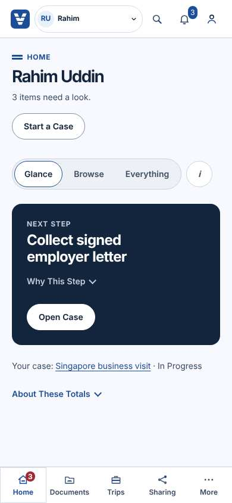 | 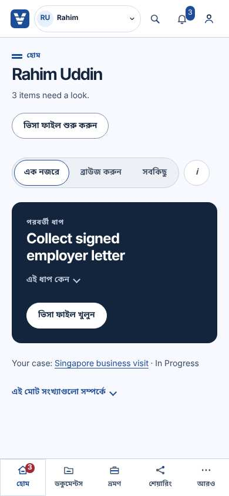 | 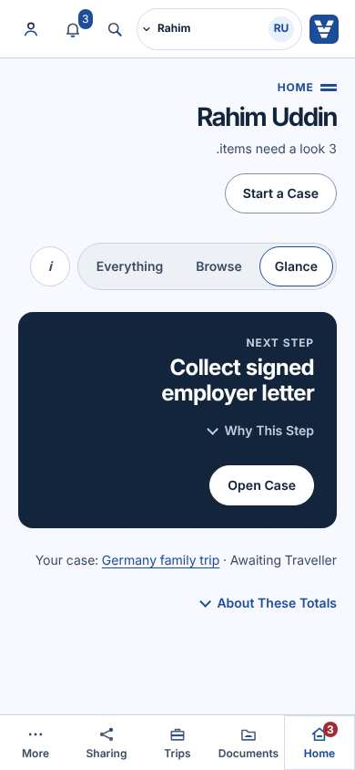 |

Measured: bn draft swapped 118 of 200 text runs (59%). Sideways overflow in pixels: English 0, bn 0, RTL 0. Clipped text blocks: English 3, bn 3, RTL 3.

| English on screen | bn-BD draft | Guardrail tags | Automated check |
|---|---|---|---|
| Sharing & Requests | শেয়ারিং ও অনুরোধ | G8_data_action | PASS |
| Sharing | শেয়ারিং | G8_data_action | PASS |
| Sharing follows your saved permissions. | শেয়ারিং আপনার সংরক্ষিত অনুমতি অনুসারে চলে। | G1_state_word, G8_data_action | PASS |
| Everything: upcoming dates, recent activity, profile and sharing. | সবকিছু: আসন্ন তারিখ, সাম্প্রতিক কার্যকলাপ, প্রোফাইল ও শেয়ারিং। | G8_data_action | PASS |
| Pick a checklist to see what is ready | কী প্রস্তুত তা দেখতে একটি চেকলিস্ট বেছে নিন | G1_state_word | PASS |
| Manage Sharing → | শেয়ারিং পরিচালনা করুন → | G8_data_action | PASS |
| About This Version | এই কপি সম্পর্কে | G6_copy_version | VERSION_CONCEPT_REVIEW: English says version; Bengali dropped it. Fine for a document copy, wrong for a snapshot, pack or product version: editor to confirm |
| Skip to Content | মূল বিষয়বস্তুতে যান |  | PASS |
| VisaStack |  |  |  |
| Menu | মেনু |  | PASS |

Human review sign-off (to be completed by the editor and, for legal wording, a qualified reviewer):

| Check | Result | Reviewer | Date |
|---|---|---|---|
| Meaning matches English | PENDING | | |
| Natural bn-BD wording | PENDING | | |
| Narrow phone fit | PENDING | | |
| Screen reader names | PENDING | | |

## J06. Traveller uploads and manages documents

- Role: traveller
- States in this journey: populated, empty, format checked, held for safety
- Semantic checks to apply: Format checked is not virus scanned; Held for safety is not deleted

### Screen: rahim__app_applicant__id__documents

| English | bn-BD draft | RTL probe |
|---|---|---|
| 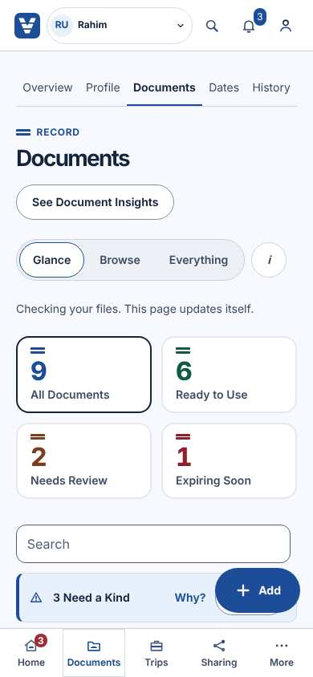 | 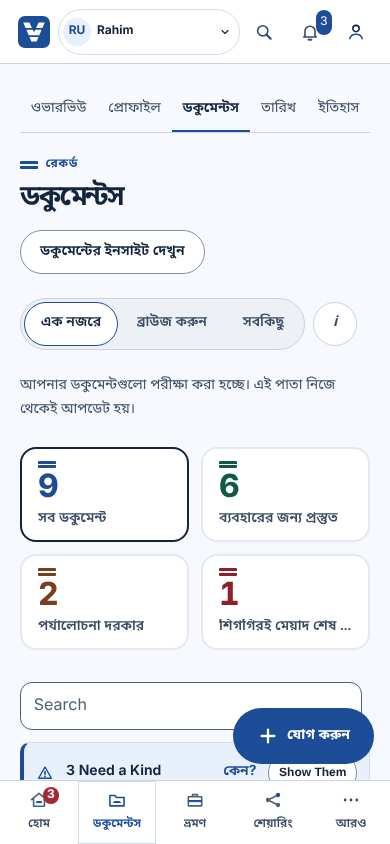 | 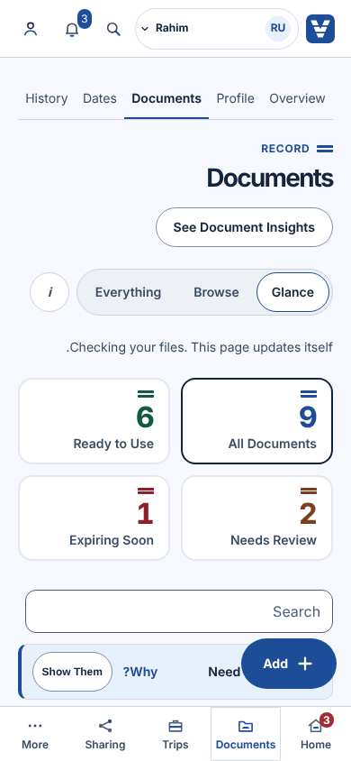 |

Measured: bn draft swapped 364 of 428 text runs (85%). Sideways overflow in pixels: English 0, bn 0, RTL 0. Clipped text blocks: English 18, bn 17, RTL 18.

| English on screen | bn-BD draft | Guardrail tags | Automated check |
|---|---|---|---|
| Sharing & Requests | শেয়ারিং ও অনুরোধ | G8_data_action | PASS |
| Sharing | শেয়ারিং | G8_data_action | PASS |
| Sharing follows your saved permissions. | শেয়ারিং আপনার সংরক্ষিত অনুমতি অনুসারে চলে। | G1_state_word, G8_data_action | PASS |
| Ready to Use | ব্যবহারের জন্য প্রস্তুত | G1_state_word | PASS |
| Held for Safety | নিরাপত্তার জন্য আটকে রাখা হয়েছে | G2_safety_check | PASS |
| Format Checked | ডকুমেন্টের ফরম্যাট পরীক্ষা করা হয়েছে | G2_safety_check | PASS (WARN_LENGTH) |
| Reviewed and Approved | পর্যালোচনা করে অনুমোদিত | G1_state_word | PASS |
| Safe Copy: Not Prepared Yet | নিরাপদ কপি: এখনো তৈরি হয়নি | G8_data_action, G9_claim_strength | PASS |
| File type checked. Not scanned for viruses. | ডকুমেন্টের ফরম্যাট পরীক্ষা করা হয়েছে। ভাইরাসের জন্য স্ক্যান করা হয়নি। | G2_safety_check | PASS |
| Safe Copy | নিরাপদ কপি | G8_data_action, G9_claim_strength | PASS |

### Screen: rahim__app_applicant__id__documents_add

| English | bn-BD draft | RTL probe |
|---|---|---|
| 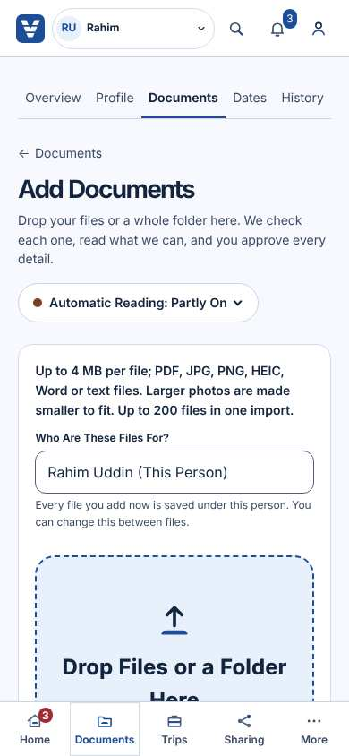 | 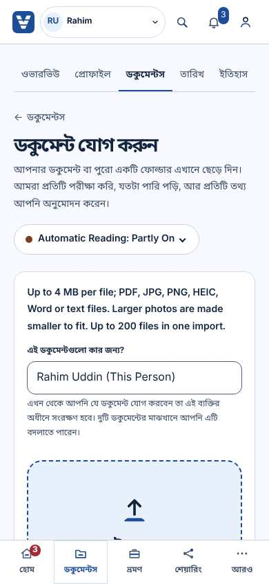 | 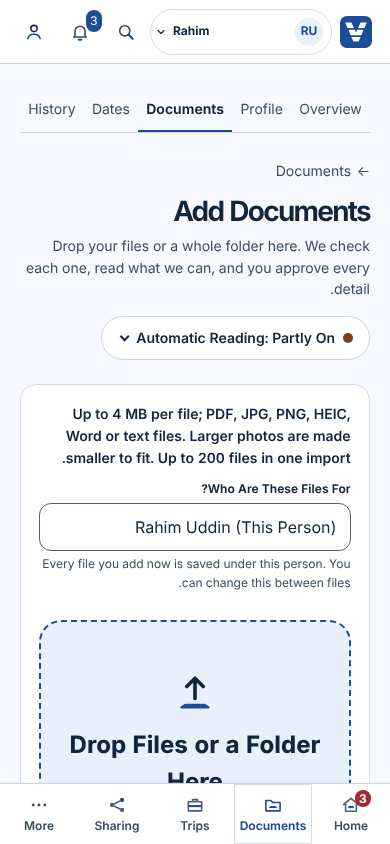 |

Measured: bn draft swapped 322 of 366 text runs (88%). Sideways overflow in pixels: English 0, bn 0, RTL 0. Clipped text blocks: English 2, bn 2, RTL 2.

| English on screen | bn-BD draft | Guardrail tags | Automated check |
|---|---|---|---|
| Sharing & Requests | শেয়ারিং ও অনুরোধ | G8_data_action | PASS |
| Sharing | শেয়ারিং | G8_data_action | PASS |
| Sharing follows your saved permissions. | শেয়ারিং আপনার সংরক্ষিত অনুমতি অনুসারে চলে। | G1_state_word, G8_data_action | PASS |
| the text of a document is sent to an AI service to suggest values. You approve each one. |  | G1_state_word | no draft |
| the picture of a scan is sent to an AI service to read it. This shares more than text alone. |  | G1_state_word, G2_safety_check | no draft |
| Every file you add now is saved under this person. You can change this between files. | এখন থেকে আপনি যে ডকুমেন্ট যোগ করবেন তা এই ব্যক্তির অধীনে সংরক্ষণ হবে। দুটি ডকুমেন্টের মাঝখানে আপনি এটি বদলাতে পারেন। | G1_state_word | PASS |
| Kind of Document (Optional) | ডকুমেন্টের ধরন (ঐচ্ছিক) | G3_requirement_level | PASS |
| Residence Permit | রেসিডেন্স পারমিট | G7_country_role | PASS |
| Temporary Residence Permit | অস্থায়ী রেসিডেন্স পারমিট | G7_country_role | PASS |
| Permanent Residence | স্থায়ী বসবাস | G7_country_role, G8_data_action | PASS |

Human review sign-off (to be completed by the editor and, for legal wording, a qualified reviewer):

| Check | Result | Reviewer | Date |
|---|---|---|---|
| Meaning matches English | PENDING | | |
| Natural bn-BD wording | PENDING | | |
| Narrow phone fit | PENDING | | |
| Screen reader names | PENDING | | |

## J07. A person approves or rejects AI suggestions from a document

- Role: traveller
- States in this journey: awaiting review, approved, rejected
- Semantic checks to apply: Approved is a person's approval of a suggestion, not a visa decision; AI never changes the profile alone

### Screen: rahim__app_applicant__id__review

| English | bn-BD draft | RTL probe |
|---|---|---|
| 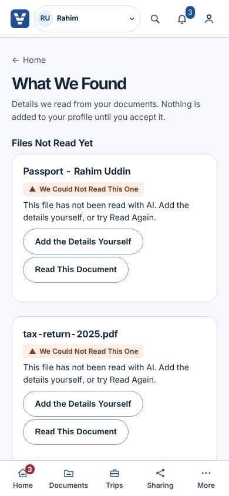 | 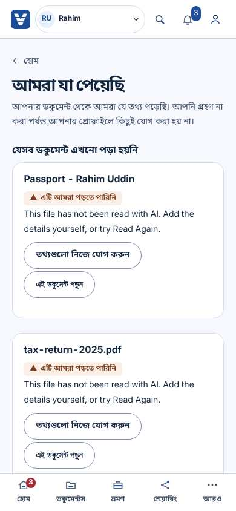 | 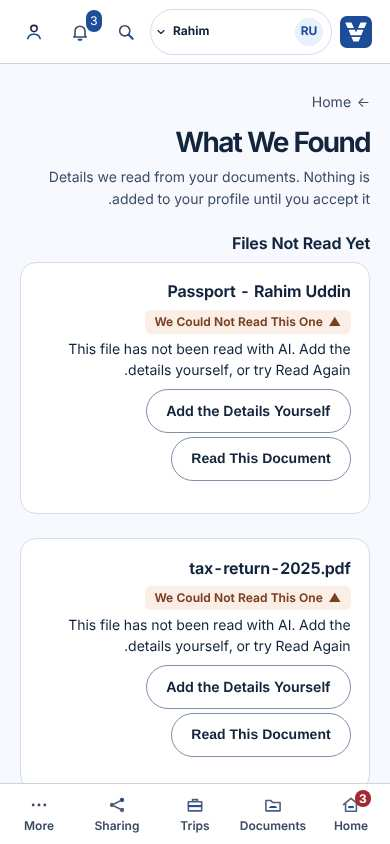 |

Measured: bn draft swapped 88 of 136 text runs (65%). Sideways overflow in pixels: English 0, bn 0, RTL 0. Clipped text blocks: English 2, bn 2, RTL 2.

| English on screen | bn-BD draft | Guardrail tags | Automated check |
|---|---|---|---|
| Sharing & Requests | শেয়ারিং ও অনুরোধ | G8_data_action | PASS |
| Sharing | শেয়ারিং | G8_data_action | PASS |
| Sharing follows your saved permissions. | শেয়ারিং আপনার সংরক্ষিত অনুমতি অনুসারে চলে। | G1_state_word, G8_data_action | PASS |
| Details we read from your documents. Nothing is added to your profile until you accept it. | আপনার ডকুমেন্ট থেকে আমরা যে তথ্য পড়েছি। আপনি গ্রহণ না করা পর্যন্ত আপনার প্রোফাইলে কিছুই যোগ করা হয় না। | G5_share_lifecycle | PASS |
| About This Version | এই কপি সম্পর্কে | G6_copy_version | VERSION_CONCEPT_REVIEW: English says version; Bengali dropped it. Fine for a document copy, wrong for a snapshot, pack or product version: editor to confirm |
| Skip to Content | মূল বিষয়বস্তুতে যান |  | PASS |
| VisaStack |  |  |  |
| Menu | মেনু |  | PASS |
| Product | প্রোডাক্ট |  | PASS |
| For Agencies | এজেন্সির জন্য |  | PASS |

### Screen: rahim__app_applicant__id__evidence

| English | bn-BD draft | RTL probe |
|---|---|---|
| 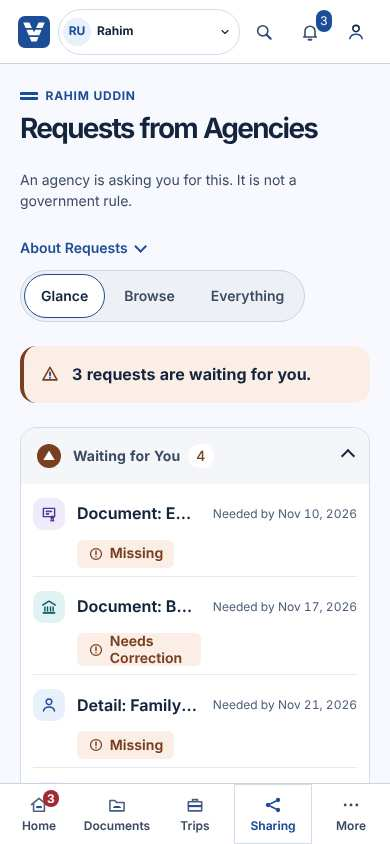 | 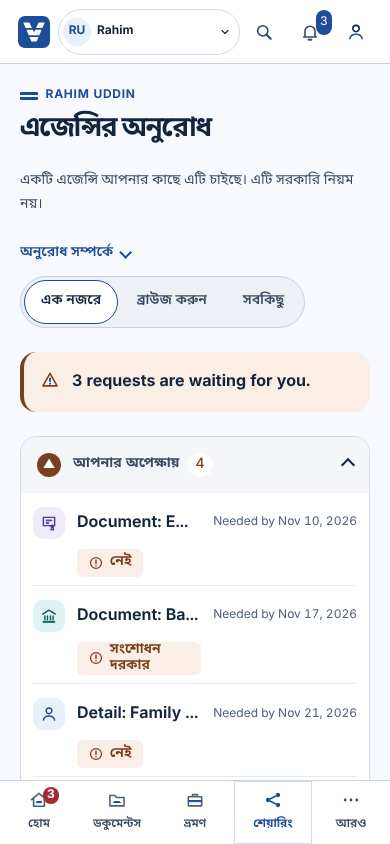 | 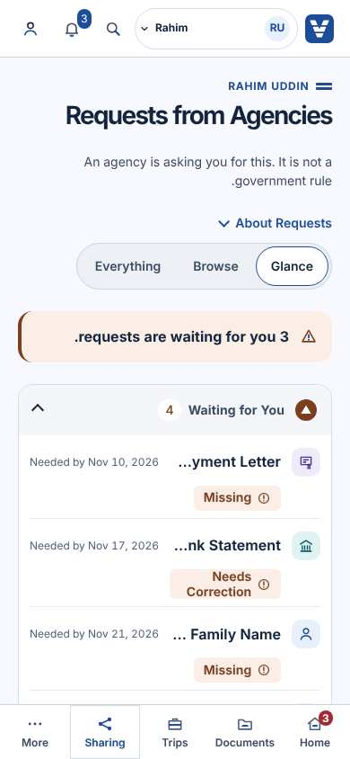 |

Measured: bn draft swapped 143 of 239 text runs (60%). Sideways overflow in pixels: English 0, bn 0, RTL 0. Clipped text blocks: English 8, bn 8, RTL 8.

| English on screen | bn-BD draft | Guardrail tags | Automated check |
|---|---|---|---|
| Sharing & Requests | শেয়ারিং ও অনুরোধ | G8_data_action | PASS |
| Sharing | শেয়ারিং | G8_data_action | PASS |
| Sharing follows your saved permissions. | শেয়ারিং আপনার সংরক্ষিত অনুমতি অনুসারে চলে। | G1_state_word, G8_data_action | PASS |
| An agency is asking you for this. It is not a government rule. | একটি এজেন্সি আপনার কাছে এটি চাইছে। এটি সরকারি নিয়ম নয়। | G4_who_is_asking | PASS |
| Reviewed | পর্যালোচনা করা হয়েছে | G1_state_word | PASS (WARN_LENGTH) |
| Sent | পাঠানো হয়েছে | G1_state_word | PASS |
| The agency can download this exact copy while it has access. | অ্যাক্সেস থাকা অবস্থায় এজেন্সি এই হুবহু কপিটি ডাউনলোড করতে পারবে। | G6_copy_version | PASS |
| Sent Back for a Fix | ঠিক করার জন্য ফেরত পাঠানো হয়েছে | G1_state_word | PASS |
| Some earlier sends have no time on record. | আগের কিছু পাঠানোর সময় রেকর্ডে নেই। | G6_copy_version | PASS |
| The file you sent could not be used. Ask the agency below and they can request a replacement. | আপনার পাঠানো ডকুমেন্টটি ব্যবহার করা যায়নি। নিচে এজেন্সিকে জিজ্ঞাসা করুন, তারা বদলি ডকুমেন্ট চাইতে পারবে। | G1_state_word | PASS |

Human review sign-off (to be completed by the editor and, for legal wording, a qualified reviewer):

| Check | Result | Reviewer | Date |
|---|---|---|---|
| Meaning matches English | PENDING | | |
| Natural bn-BD wording | PENDING | | |
| Narrow phone fit | PENDING | | |
| Screen reader names | PENDING | | |

## J08. Start a case and read readiness with unknown requirements

- Role: traveller
- States in this journey: ready, needs more, manual only
- Semantic checks to apply: Mandatory vs optional vs unknown; Ready is not Submitted

### Screen: rahim__app_mission_start

| English | bn-BD draft | RTL probe |
|---|---|---|
| 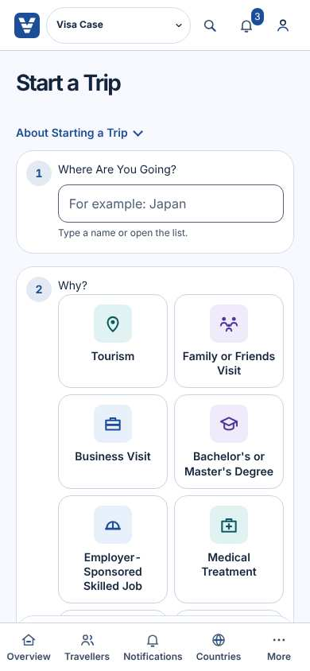 | 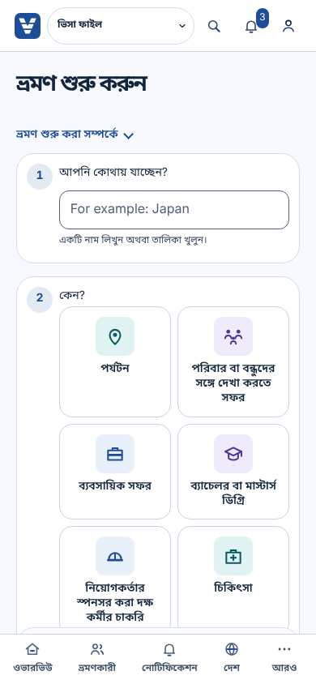 | 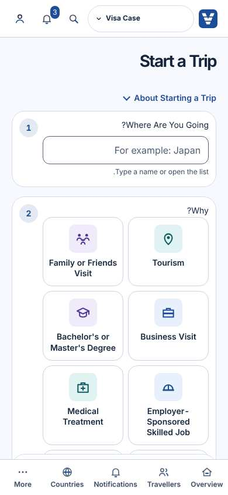 |

Measured: bn draft swapped 77 of 111 text runs (69%). Sideways overflow in pixels: English 0, bn 0, RTL 0. Clipped text blocks: English 3, bn 3, RTL 3.

| English on screen | bn-BD draft | Guardrail tags | Automated check |
|---|---|---|---|
| Sharing follows your saved permissions. | শেয়ারিং আপনার সংরক্ষিত অনুমতি অনুসারে চলে। | G1_state_word, G8_data_action | PASS |
| About This Version | এই কপি সম্পর্কে | G6_copy_version | VERSION_CONCEPT_REVIEW: English says version; Bengali dropped it. Fine for a document copy, wrong for a snapshot, pack or product version: editor to confirm |
| Skip to Content | মূল বিষয়বস্তুতে যান |  | PASS |
| VisaStack |  |  |  |
| Menu | মেনু |  | PASS |
| Product | প্রোডাক্ট |  | PASS |
| For Agencies | এজেন্সির জন্য |  | PASS |
| Privacy and Control | গোপনীয়তা ও নিয়ন্ত্রণ |  | PASS |
| How It Works | এটি যেভাবে কাজ করে |  | PASS |
| Workspace | ওয়ার্কস্পেস |  | PASS |

### Screen: rahim__app_mission__id_

| English | bn-BD draft | RTL probe |
|---|---|---|
| 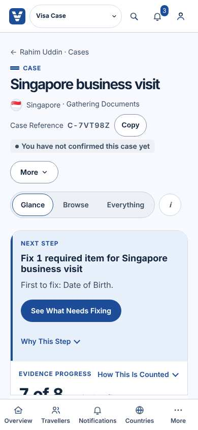 | 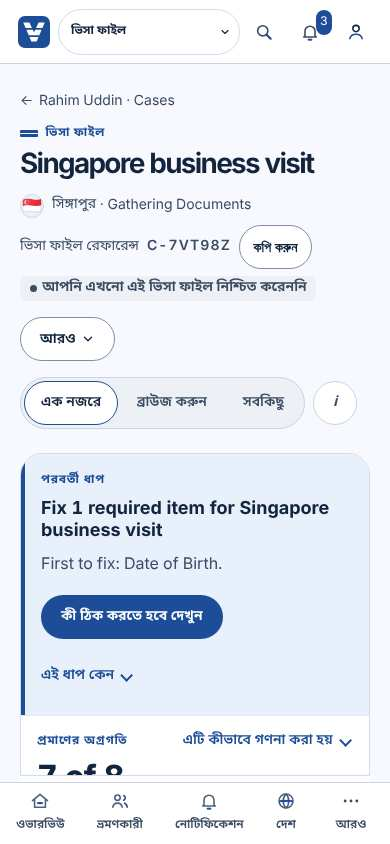 | 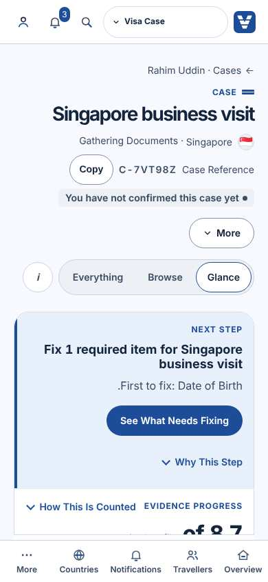 |

Measured: bn draft swapped 478 of 681 text runs (70%). Sideways overflow in pixels: English 0, bn 0, RTL 0. Clipped text blocks: English 4, bn 4, RTL 4.

| English on screen | bn-BD draft | Guardrail tags | Automated check |
|---|---|---|---|
| Sharing follows your saved permissions. | শেয়ারিং আপনার সংরক্ষিত অনুমতি অনুসারে চলে। | G1_state_word, G8_data_action | PASS |
| You have not confirmed this case yet | আপনি এখনো এই ভিসা ফাইল নিশ্চিত করেননি | G1_state_word | PASS |
| Some required items are missing, out of date or do not match. | কিছু আবশ্যক আইটেম অনুপস্থিত, পুরোনো বা মিলছে না। | G3_requirement_level | PASS |
| Not Applicable | প্রযোজ্য নয় | G3_requirement_level | PASS |
| Optional Not Provided | ঐচ্ছিক, দেওয়া হয়নি | G3_requirement_level | PASS |
| Readiness is completeness only - never an approval likelihood. | প্রস্তুতি মানে শুধু সম্পূর্ণতা - এটি কখনোই অনুমোদনের সম্ভাবনা নয়। | G9_claim_strength | PASS |
| Ready for Review | পর্যালোচনার জন্য প্রস্তুত | G1_state_word | PASS |
| Ready to Export | এক্সপোর্টের জন্য প্রস্তুত | G1_state_word, G8_data_action | PASS |
| Submission Ready | জমা দেওয়ার জন্য প্রস্তুত | G1_state_word | PASS |
| Submitted | জমা দেওয়া হয়েছে | G1_state_word | PASS |

Human review sign-off (to be completed by the editor and, for legal wording, a qualified reviewer):

| Check | Result | Reviewer | Date |
|---|---|---|---|
| Meaning matches English | PENDING | | |
| Natural bn-BD wording | PENDING | | |
| Narrow phone fit | PENDING | | |
| Screen reader names | PENDING | | |

## J09. Country guide: what each country asks for

- Role: traveller
- States in this journey: populated, unknown rules
- Semantic checks to apply: no invented official requirement; nationality vs residence vs destination vs place of application

### Screen: rahim__app_countries__list_

| English | bn-BD draft | RTL probe |
|---|---|---|
| 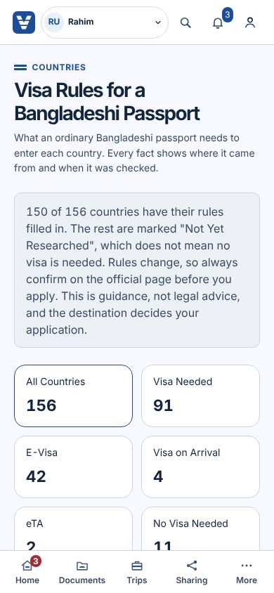 | 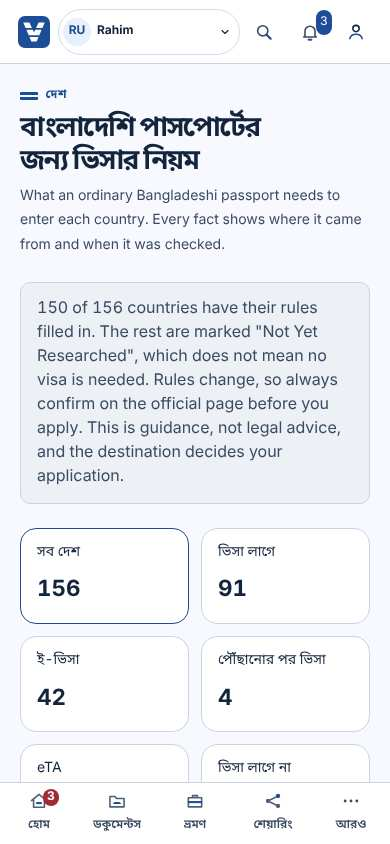 |  |

Measured: bn draft swapped 90 of 153 text runs (59%). Sideways overflow in pixels: English 0, bn 0, RTL 0. Clipped text blocks: English 3, bn 3, RTL 3.

| English on screen | bn-BD draft | Guardrail tags | Automated check |
|---|---|---|---|
| Sharing & Requests | শেয়ারিং ও অনুরোধ | G8_data_action | PASS |
| Sharing | শেয়ারিং | G8_data_action | PASS |
| Sharing follows your saved permissions. | শেয়ারিং আপনার সংরক্ষিত অনুমতি অনুসারে চলে। | G1_state_word, G8_data_action | PASS |
| About This Version | এই কপি সম্পর্কে | G6_copy_version | VERSION_CONCEPT_REVIEW: English says version; Bengali dropped it. Fine for a document copy, wrong for a snapshot, pack or product version: editor to confirm |
| Skip to Content | মূল বিষয়বস্তুতে যান |  | PASS |
| VisaStack |  |  |  |
| Menu | মেনু |  | PASS |
| Product | প্রোডাক্ট |  | PASS |
| For Agencies | এজেন্সির জন্য |  | PASS |
| Privacy and Control | গোপনীয়তা ও নিয়ন্ত্রণ |  | PASS |

### Screen: rahim__app_countries__iso2_

| English | bn-BD draft | RTL probe |
|---|---|---|
|  |  |  |

Measured: bn draft swapped 82 of 134 text runs (61%). Sideways overflow in pixels: English 0, bn 0, RTL 0. Clipped text blocks: English 2, bn 2, RTL 2.

| English on screen | bn-BD draft | Guardrail tags | Automated check |
|---|---|---|---|
| Sharing & Requests | শেয়ারিং ও অনুরোধ | G8_data_action | PASS |
| Sharing | শেয়ারিং | G8_data_action | PASS |
| Sharing follows your saved permissions. | শেয়ারিং আপনার সংরক্ষিত অনুমতি অনুসারে চলে। | G1_state_word, G8_data_action | PASS |
| The Short Version | সংক্ষেপে | G6_copy_version | VERSION_CONCEPT_REVIEW: English says version; Bengali dropped it. Fine for a document copy, wrong for a snapshot, pack or product version: editor to confirm |
| Through a visa application centre | ভিসা আবেদন কেন্দ্রের মাধ্যমে | G4_who_is_asking | PASS |
| Official Page | অফিসিয়াল পাতা | G9_claim_strength | PASS |
| This list may not be complete. Check the official page for everything you need to submit. | এই তালিকা সম্পূর্ণ নাও হতে পারে। জমা দিতে আপনার যা যা লাগবে তার জন্য অফিসিয়াল পাতা দেখে নিন। | G9_claim_strength | PASS |
| About This Version | এই কপি সম্পর্কে | G6_copy_version | VERSION_CONCEPT_REVIEW: English says version; Bengali dropped it. Fine for a document copy, wrong for a snapshot, pack or product version: editor to confirm |
| Skip to Content | মূল বিষয়বস্তুতে যান |  | PASS |
| VisaStack |  |  |  |

Human review sign-off (to be completed by the editor and, for legal wording, a qualified reviewer):

| Check | Result | Reviewer | Date |
|---|---|---|---|
| Meaning matches English | PENDING | | |
| Natural bn-BD wording | PENDING | | |
| Narrow phone fit | PENDING | | |
| Screen reader names | PENDING | | |

## J10. Share a record with an agency and choose what they can see

- Role: traveller
- States in this journey: pending acceptance, active, scope
- Semantic checks to apply: Link opened is not grant accepted; scope wording

### Screen: rahim__app_applicant__id__sharing

| English | bn-BD draft | RTL probe |
|---|---|---|
|  |  |  |

Measured: bn draft swapped 172 of 241 text runs (71%). Sideways overflow in pixels: English 0, bn 0, RTL 0. Clipped text blocks: English 3, bn 3, RTL 3.

| English on screen | bn-BD draft | Guardrail tags | Automated check |
|---|---|---|---|
| Sharing & Requests | শেয়ারিং ও অনুরোধ | G8_data_action | PASS |
| Sharing | শেয়ারিং | G8_data_action | PASS |
| Sharing follows your saved permissions. | শেয়ারিং আপনার সংরক্ষিত অনুমতি অনুসারে চলে। | G1_state_word, G8_data_action | PASS |
| New Sharing Request | নতুন শেয়ারিংয়ের অনুরোধ | G8_data_action | PASS |
| About Sharing | শেয়ারিং সম্পর্কে | G8_data_action | PASS |
| Pausing or revoking stops access now; copies already downloaded cannot be erased. | স্থগিত বা প্রত্যাহার করলে এখন থেকে অ্যাক্সেস বন্ধ হয়; আগে ডাউনলোড হয়ে যাওয়া কপি মুছে ফেলা যায় না। | G5_share_lifecycle | PASS |
| What actually happened to your data, not just what a grant permits. | আপনার তথ্যের সঙ্গে আসলে কী ঘটেছে, শুধু কোনো অ্যাক্সেস কী অনুমতি দেয় তা নয়। | G4_who_is_asking | PASS |
| Back to Sharing | শেয়ারিংয়ে ফিরে যান | G8_data_action | PASS |
| Let This Agency Use AI Tools on What I Share | আমি যা শেয়ার করি, তাতে এই এজেন্সিকে এআই টুল ব্যবহার করতে দিন | G8_data_action | PASS |
| Grant Access | অ্যাক্সেস দিন | G4_who_is_asking | PASS |

### Screen: rahim__app_applicant__id__outputs

| English | bn-BD draft | RTL probe |
|---|---|---|
|  |  |  |

Measured: bn draft swapped 176 of 270 text runs (65%). Sideways overflow in pixels: English 0, bn 0, RTL 0. Clipped text blocks: English 7, bn 7, RTL 7.

| English on screen | bn-BD draft | Guardrail tags | Automated check |
|---|---|---|---|
| Sharing & Requests | শেয়ারিং ও অনুরোধ | G8_data_action | PASS |
| Sharing | শেয়ারিং | G8_data_action | PASS |
| Sharing follows your saved permissions. | শেয়ারিং আপনার সংরক্ষিত অনুমতি অনুসারে চলে। | G1_state_word, G8_data_action | PASS |
| Confirmed Information Sheet | নিশ্চিত করা তথ্যপত্র | G1_state_word | PASS |
| The details you have confirmed, laid out to copy into a form. | আপনার নিশ্চিত করা তথ্য, একটি ফর্মে কপি করার মতো করে সাজানো। | G1_state_word | PASS |
| Details that only some purposes need: study, work, business, family, official. | যে তথ্য শুধু কিছু উদ্দেশ্যে দরকার হয়: পড়াশোনা, কাজ, ব্যবসা, পরিবার, দাপ্তরিক। | G9_claim_strength | PASS |
| As Standard, plus suggestions that are not confirmed yet, labelled as such. | স্ট্যান্ডার্ডের মতোই, সঙ্গে এখনো নিশ্চিত নয় এমন পরামর্শ, যেগুলো সেভাবেই চিহ্নিত করা থাকে। | G1_state_word | PASS |
| Destination | গন্তব্য | G7_country_role | PASS |
| Required Items Ready | আবশ্যক বিষয়গুলো প্রস্তুত | G1_state_word, G3_requirement_level | PASS |
| Completeness only. It says nothing about whether an application will be accepted | শুধু সম্পূর্ণতা। আবেদন গ্রহণ করা হবে কি না সে বিষয়ে এটি কিছুই বলে না | G1_state_word, G5_share_lifecycle | PASS |

Human review sign-off (to be completed by the editor and, for legal wording, a qualified reviewer):

| Check | Result | Reviewer | Date |
|---|---|---|---|
| Meaning matches English | PENDING | | |
| Natural bn-BD wording | PENDING | | |
| Narrow phone fit | PENDING | | |
| Screen reader names | PENDING | | |

## J11. Revoke access and understand the copy already kept

- Role: traveller
- States in this journey: revoked, expired, history
- Semantic checks to apply: Revoked does not claim a downloaded copy was taken back

### Screen: rahim__app_applicant__id__sharing

| English | bn-BD draft | RTL probe |
|---|---|---|
|  |  |  |

Measured: bn draft swapped 172 of 241 text runs (71%). Sideways overflow in pixels: English 0, bn 0, RTL 0. Clipped text blocks: English 3, bn 3, RTL 3.

| English on screen | bn-BD draft | Guardrail tags | Automated check |
|---|---|---|---|
| Sharing & Requests | শেয়ারিং ও অনুরোধ | G8_data_action | PASS |
| Sharing | শেয়ারিং | G8_data_action | PASS |
| Sharing follows your saved permissions. | শেয়ারিং আপনার সংরক্ষিত অনুমতি অনুসারে চলে। | G1_state_word, G8_data_action | PASS |
| New Sharing Request | নতুন শেয়ারিংয়ের অনুরোধ | G8_data_action | PASS |
| About Sharing | শেয়ারিং সম্পর্কে | G8_data_action | PASS |
| Pausing or revoking stops access now; copies already downloaded cannot be erased. | স্থগিত বা প্রত্যাহার করলে এখন থেকে অ্যাক্সেস বন্ধ হয়; আগে ডাউনলোড হয়ে যাওয়া কপি মুছে ফেলা যায় না। | G5_share_lifecycle | PASS |
| What actually happened to your data, not just what a grant permits. | আপনার তথ্যের সঙ্গে আসলে কী ঘটেছে, শুধু কোনো অ্যাক্সেস কী অনুমতি দেয় তা নয়। | G4_who_is_asking | PASS |
| Back to Sharing | শেয়ারিংয়ে ফিরে যান | G8_data_action | PASS |
| Let This Agency Use AI Tools on What I Share | আমি যা শেয়ার করি, তাতে এই এজেন্সিকে এআই টুল ব্যবহার করতে দিন | G8_data_action | PASS |
| Grant Access | অ্যাক্সেস দিন | G4_who_is_asking | PASS |

### Screen: rahim__app_shared__list_

| English | bn-BD draft | RTL probe |
|---|---|---|
|  |  |  |

Measured: bn draft swapped 68 of 106 text runs (64%). Sideways overflow in pixels: English 0, bn 0, RTL 0. Clipped text blocks: English 2, bn 2, RTL 2.

| English on screen | bn-BD draft | Guardrail tags | Automated check |
|---|---|---|---|
| Sharing & Requests | শেয়ারিং ও অনুরোধ | G8_data_action | PASS |
| Sharing | শেয়ারিং | G8_data_action | PASS |
| Sharing follows your saved permissions. | শেয়ারিং আপনার সংরক্ষিত অনুমতি অনুসারে চলে। | G1_state_word, G8_data_action | PASS |
| Someone granted you access to their records. Access only begins once you accept. | কেউ আপনাকে তাঁর রেকর্ডে অ্যাক্সেস দিয়েছেন। আপনি গ্রহণ করার পরেই অ্যাক্সেস শুরু হবে। | G5_share_lifecycle | PASS |
| Accept Access | অ্যাক্সেস গ্রহণ করুন | G5_share_lifecycle | PASS |
| About This Version | এই কপি সম্পর্কে | G6_copy_version | VERSION_CONCEPT_REVIEW: English says version; Bengali dropped it. Fine for a document copy, wrong for a snapshot, pack or product version: editor to confirm |
| Skip to Content | মূল বিষয়বস্তুতে যান |  | PASS |
| VisaStack |  |  |  |
| Menu | মেনু |  | PASS |
| Product | প্রোডাক্ট |  | PASS |

Human review sign-off (to be completed by the editor and, for legal wording, a qualified reviewer):

| Check | Result | Reviewer | Date |
|---|---|---|---|
| Meaning matches English | PENDING | | |
| Natural bn-BD wording | PENDING | | |
| Narrow phone fit | PENDING | | |
| Screen reader names | PENDING | | |

## J12. Someone receives an invitation or a shared record

- Role: invitee
- States in this journey: awaiting acceptance, accepted
- Semantic checks to apply: Accepted is not Approved

### Screen: rahim__app_shared__list_

| English | bn-BD draft | RTL probe |
|---|---|---|
|  |  |  |

Measured: bn draft swapped 68 of 106 text runs (64%). Sideways overflow in pixels: English 0, bn 0, RTL 0. Clipped text blocks: English 2, bn 2, RTL 2.

| English on screen | bn-BD draft | Guardrail tags | Automated check |
|---|---|---|---|
| Sharing & Requests | শেয়ারিং ও অনুরোধ | G8_data_action | PASS |
| Sharing | শেয়ারিং | G8_data_action | PASS |
| Sharing follows your saved permissions. | শেয়ারিং আপনার সংরক্ষিত অনুমতি অনুসারে চলে। | G1_state_word, G8_data_action | PASS |
| Someone granted you access to their records. Access only begins once you accept. | কেউ আপনাকে তাঁর রেকর্ডে অ্যাক্সেস দিয়েছেন। আপনি গ্রহণ করার পরেই অ্যাক্সেস শুরু হবে। | G5_share_lifecycle | PASS |
| Accept Access | অ্যাক্সেস গ্রহণ করুন | G5_share_lifecycle | PASS |
| About This Version | এই কপি সম্পর্কে | G6_copy_version | VERSION_CONCEPT_REVIEW: English says version; Bengali dropped it. Fine for a document copy, wrong for a snapshot, pack or product version: editor to confirm |
| Skip to Content | মূল বিষয়বস্তুতে যান |  | PASS |
| VisaStack |  |  |  |
| Menu | মেনু |  | PASS |
| Product | প্রোডাক্ট |  | PASS |

### Screen: rahim__app_shared__grantId_

| English | bn-BD draft | RTL probe |
|---|---|---|
|  |  |  |

Measured: bn draft swapped 71 of 105 text runs (68%). Sideways overflow in pixels: English 0, bn 0, RTL 0. Clipped text blocks: English 2, bn 2, RTL 2.

| English on screen | bn-BD draft | Guardrail tags | Automated check |
|---|---|---|---|
| Sharing & Requests | শেয়ারিং ও অনুরোধ | G8_data_action | PASS |
| Sharing | শেয়ারিং | G8_data_action | PASS |
| Sharing follows your saved permissions. | শেয়ারিং আপনার সংরক্ষিত অনুমতি অনুসারে চলে। | G1_state_word, G8_data_action | PASS |
| About This Version | এই কপি সম্পর্কে | G6_copy_version | VERSION_CONCEPT_REVIEW: English says version; Bengali dropped it. Fine for a document copy, wrong for a snapshot, pack or product version: editor to confirm |
| Skip to Content | মূল বিষয়বস্তুতে যান |  | PASS |
| VisaStack |  |  |  |
| Menu | মেনু |  | PASS |
| Product | প্রোডাক্ট |  | PASS |
| For Agencies | এজেন্সির জন্য |  | PASS |
| Privacy and Control | গোপনীয়তা ও নিয়ন্ত্রণ |  | PASS |

Human review sign-off (to be completed by the editor and, for legal wording, a qualified reviewer):

| Check | Result | Reviewer | Date |
|---|---|---|---|
| Meaning matches English | PENDING | | |
| Natural bn-BD wording | PENDING | | |
| Narrow phone fit | PENDING | | |
| Screen reader names | PENDING | | |

## J13. New agency sets up the team and invites clients

- Role: agency
- States in this journey: empty, first run
- Semantic checks to apply: agency request vs grant vs government application

### Screen: agencyNew__app_agency__new-agency

| English | bn-BD draft | RTL probe |
|---|---|---|
|  |  |  |

Measured: bn draft swapped 70 of 85 text runs (82%). Sideways overflow in pixels: English 0, bn 0, RTL 0. Clipped text blocks: English 2, bn 2, RTL 2.

| English on screen | bn-BD draft | Guardrail tags | Automated check |
|---|---|---|---|
| Sharing follows your saved permissions. | শেয়ারিং আপনার সংরক্ষিত অনুমতি অনুসারে চলে। | G1_state_word, G8_data_action | PASS |
| About This Version | এই কপি সম্পর্কে | G6_copy_version | VERSION_CONCEPT_REVIEW: English says version; Bengali dropped it. Fine for a document copy, wrong for a snapshot, pack or product version: editor to confirm |
| Skip to Content | মূল বিষয়বস্তুতে যান |  | PASS |
| VisaStack |  |  |  |
| Menu | মেনু |  | PASS |
| Product | প্রোডাক্ট |  | PASS |
| For Agencies | এজেন্সির জন্য |  | PASS |
| Privacy and Control | গোপনীয়তা ও নিয়ন্ত্রণ |  | PASS |
| How It Works | এটি যেভাবে কাজ করে |  | PASS |
| Workspace | ওয়ার্কস্পেস |  | PASS |

### Screen: agencyNew__app_agency__orgId___new-agency

| English | bn-BD draft | RTL probe |
|---|---|---|
|  |  |  |

Measured: bn draft swapped 143 of 170 text runs (84%). Sideways overflow in pixels: English 0, bn 0, RTL 0. Clipped text blocks: English 4, bn 4, RTL 4.

| English on screen | bn-BD draft | Guardrail tags | Automated check |
|---|---|---|---|
| Sharing follows your saved permissions. | শেয়ারিং আপনার সংরক্ষিত অনুমতি অনুসারে চলে। | G1_state_word, G8_data_action | PASS |
| Invite a Client | ক্লায়েন্টকে আমন্ত্রণ জানান | G5_share_lifecycle | PASS |
| Submission Ready | জমা দেওয়ার জন্য প্রস্তুত | G1_state_word | PASS |
| Submitted | জমা দেওয়া হয়েছে | G1_state_word | PASS |
| Ready for Review | পর্যালোচনার জন্য প্রস্তুত | G1_state_word | PASS |
| Ready to Export | এক্সপোর্টের জন্য প্রস্তুত | G1_state_word, G8_data_action | PASS |
| Destination | গন্তব্য | G7_country_role | PASS |
| No cases are reachable yet - a traveller must grant this organization access to a specific case. | পৌঁছানো যায় এমন কোনো ভিসা ফাইল এখনো নেই - কোনো ভ্রমণকারীকে নির্দিষ্ট একটি ভিসা ফাইলে এই প্রতিষ্ঠানকে অ্যাক্সেস দিতে হবে। | G4_who_is_asking | PASS |
| Once a client accepts, their cases appear here with how many checklist items are ready. | ক্লায়েন্ট গ্রহণ করলে তাঁদের ভিসা ফাইল এখানে দেখা যাবে, সঙ্গে চেকলিস্টের কয়টি আইটেম প্রস্তুত তা-ও থাকবে। | G1_state_word | PASS |
| About This Version | এই কপি সম্পর্কে | G6_copy_version | VERSION_CONCEPT_REVIEW: English says version; Bengali dropped it. Fine for a document copy, wrong for a snapshot, pack or product version: editor to confirm |

Human review sign-off (to be completed by the editor and, for legal wording, a qualified reviewer):

| Check | Result | Reviewer | Date |
|---|---|---|---|
| Meaning matches English | PENDING | | |
| Natural bn-BD wording | PENDING | | |
| Narrow phone fit | PENDING | | |
| Screen reader names | PENDING | | |

## J14. Agency works its cases and reviews evidence

- Role: agency
- States in this journey: populated, owner vs member
- Semantic checks to apply: Reviewed is not Approved or Verified

### Screen: agencyOwner__app_agency__orgId_

| English | bn-BD draft | RTL probe |
|---|---|---|
|  |  |  |

Measured: bn draft swapped 242 of 405 text runs (60%). Sideways overflow in pixels: English 0, bn 0, RTL 0. Clipped text blocks: English 4, bn 4, RTL 4.

| English on screen | bn-BD draft | Guardrail tags | Automated check |
|---|---|---|---|
| Sharing follows your saved permissions. | শেয়ারিং আপনার সংরক্ষিত অনুমতি অনুসারে চলে। | G1_state_word, G8_data_action | PASS |
| Invite a Client | ক্লায়েন্টকে আমন্ত্রণ জানান | G5_share_lifecycle | PASS |
| Submission Ready | জমা দেওয়ার জন্য প্রস্তুত | G1_state_word | PASS |
| Submitted | জমা দেওয়া হয়েছে | G1_state_word | PASS |
| Ready for Review | পর্যালোচনার জন্য প্রস্তুত | G1_state_word | PASS |
| Ready to Export | এক্সপোর্টের জন্য প্রস্তুত | G1_state_word, G8_data_action | PASS |
| Destination | গন্তব্য | G7_country_role | PASS |
| Traveller Confirmed | ভ্রমণকারী নিশ্চিত করেছেন | G1_state_word | PASS |
| About This Version | এই কপি সম্পর্কে | G6_copy_version | VERSION_CONCEPT_REVIEW: English says version; Bengali dropped it. Fine for a document copy, wrong for a snapshot, pack or product version: editor to confirm |
| Skip to Content | মূল বিষয়বস্তুতে যান |  | PASS |

### Screen: agencyOwner__app_agency__orgId__cases

| English | bn-BD draft | RTL probe |
|---|---|---|
|  |  |  |

Measured: bn draft swapped 108 of 205 text runs (53%). Sideways overflow in pixels: English 0, bn 0, RTL 0. Clipped text blocks: English 3, bn 3, RTL 3.

| English on screen | bn-BD draft | Guardrail tags | Automated check |
|---|---|---|---|
| Sharing follows your saved permissions. | শেয়ারিং আপনার সংরক্ষিত অনুমতি অনুসারে চলে। | G1_state_word, G8_data_action | PASS |
| Assign a team member and leave case notes on any case this organization has a grant for. | যে ভিসা ফাইলে এই প্রতিষ্ঠানের অ্যাক্সেস-অনুমতি আছে, সেখানে টিমের একজন সদস্যকে দায়িত্ব দিন এবং ভিসা ফাইলের নোট রাখুন। | G4_who_is_asking | PASS |
| About This Version | এই কপি সম্পর্কে | G6_copy_version | VERSION_CONCEPT_REVIEW: English says version; Bengali dropped it. Fine for a document copy, wrong for a snapshot, pack or product version: editor to confirm |
| Skip to Content | মূল বিষয়বস্তুতে যান |  | PASS |
| VisaStack |  |  |  |
| Menu | মেনু |  | PASS |
| Product | প্রোডাক্ট |  | PASS |
| For Agencies | এজেন্সির জন্য |  | PASS |
| Privacy and Control | গোপনীয়তা ও নিয়ন্ত্রণ |  | PASS |
| How It Works | এটি যেভাবে কাজ করে |  | PASS |

Human review sign-off (to be completed by the editor and, for legal wording, a qualified reviewer):

| Check | Result | Reviewer | Date |
|---|---|---|---|
| Meaning matches English | PENDING | | |
| Natural bn-BD wording | PENDING | | |
| Narrow phone fit | PENDING | | |
| Screen reader names | PENDING | | |

## J15. Exact-copy receipt: what was sent, frozen at that moment

- Role: traveller
- States in this journey: populated
- Semantic checks to apply: Current copy vs earlier document vs exact copy; no Version 2 wording

### Screen: rahim__app_mission__id__snapshots

| English | bn-BD draft | RTL probe |
|---|---|---|
|  |  |  |

Measured: bn draft swapped 58 of 87 text runs (67%). Sideways overflow in pixels: English 0, bn 0, RTL 0. Clipped text blocks: English 2, bn 2, RTL 2.

| English on screen | bn-BD draft | Guardrail tags | Automated check |
|---|---|---|---|
| Sharing follows your saved permissions. | শেয়ারিং আপনার সংরক্ষিত অনুমতি অনুসারে চলে। | G1_state_word, G8_data_action | PASS |
| About This Version | এই কপি সম্পর্কে | G6_copy_version | VERSION_CONCEPT_REVIEW: English says version; Bengali dropped it. Fine for a document copy, wrong for a snapshot, pack or product version: editor to confirm |
| Skip to Content | মূল বিষয়বস্তুতে যান |  | PASS |
| VisaStack |  |  |  |
| Menu | মেনু |  | PASS |
| Product | প্রোডাক্ট |  | PASS |
| For Agencies | এজেন্সির জন্য |  | PASS |
| Privacy and Control | গোপনীয়তা ও নিয়ন্ত্রণ |  | PASS |
| How It Works | এটি যেভাবে কাজ করে |  | PASS |
| Workspace | ওয়ার্কস্পেস |  | PASS |

### Screen: rahim__app_applicant__id__outputs

| English | bn-BD draft | RTL probe |
|---|---|---|
|  |  |  |

Measured: bn draft swapped 176 of 270 text runs (65%). Sideways overflow in pixels: English 0, bn 0, RTL 0. Clipped text blocks: English 7, bn 7, RTL 7.

| English on screen | bn-BD draft | Guardrail tags | Automated check |
|---|---|---|---|
| Sharing & Requests | শেয়ারিং ও অনুরোধ | G8_data_action | PASS |
| Sharing | শেয়ারিং | G8_data_action | PASS |
| Sharing follows your saved permissions. | শেয়ারিং আপনার সংরক্ষিত অনুমতি অনুসারে চলে। | G1_state_word, G8_data_action | PASS |
| Confirmed Information Sheet | নিশ্চিত করা তথ্যপত্র | G1_state_word | PASS |
| The details you have confirmed, laid out to copy into a form. | আপনার নিশ্চিত করা তথ্য, একটি ফর্মে কপি করার মতো করে সাজানো। | G1_state_word | PASS |
| Details that only some purposes need: study, work, business, family, official. | যে তথ্য শুধু কিছু উদ্দেশ্যে দরকার হয়: পড়াশোনা, কাজ, ব্যবসা, পরিবার, দাপ্তরিক। | G9_claim_strength | PASS |
| As Standard, plus suggestions that are not confirmed yet, labelled as such. | স্ট্যান্ডার্ডের মতোই, সঙ্গে এখনো নিশ্চিত নয় এমন পরামর্শ, যেগুলো সেভাবেই চিহ্নিত করা থাকে। | G1_state_word | PASS |
| Destination | গন্তব্য | G7_country_role | PASS |
| Required Items Ready | আবশ্যক বিষয়গুলো প্রস্তুত | G1_state_word, G3_requirement_level | PASS |
| Completeness only. It says nothing about whether an application will be accepted | শুধু সম্পূর্ণতা। আবেদন গ্রহণ করা হবে কি না সে বিষয়ে এটি কিছুই বলে না | G1_state_word, G5_share_lifecycle | PASS |

Human review sign-off (to be completed by the editor and, for legal wording, a qualified reviewer):

| Check | Result | Reviewer | Date |
|---|---|---|---|
| Meaning matches English | PENDING | | |
| Natural bn-BD wording | PENDING | | |
| Narrow phone fit | PENDING | | |
| Screen reader names | PENDING | | |

## J16. Guest request: an agency asks a person for documents; the guest uploads without an account

- Role: guest
- States in this journey: link opened, identity proof, upload, done, expired
- Semantic checks to apply: Link opened is not access granted; guest has no wallet
- Note: Not rendered in the preview world: these screens need a one-time link and stored requests. Source rows only.
- No rendered screen is available for this journey. The strings below come from source files only.

| Source | English | bn-BD draft | Check |
|---|---|---|---|
| collection/actions.ts:47 | This request is not available. Reload the page and try again. |  |  |
| collection/actions.ts:90 | Choose a destination. | একটি গন্তব্য বেছে নিন। | PASS |
| collection/actions.ts:95 | Choose a purpose, or Not Sure Yet. |  |  |
| collection/actions.ts:101 | Enter a valid due date. |  |  |
| collection/actions.ts:176 | Checklist updated. |  |  |
| collection/actions.ts:190 | Choose a checklist. |  |  |
| collection/actions.ts:202 | Official checklist applied. |  |  |
| collection/actions.ts:202 | Now your agency checklist. |  |  |
| collection/actions.ts:221 | Revision {revisionNo} issued. Copy the link now: it is shown only once. | {revisionNo} নম্বর কপি ইস্যু করা হয়েছে। এখনই লিংকটি কপি করুন: এটি শুধু একবারই দেখানো হয়। | PASS |
| collection/actions.ts:241 | New link ready. Copy it now: it is shown only once. | নতুন লিংক প্রস্তুত। এখনই কপি করুন: এটি শুধু একবারই দেখানো হয়। | PASS |
| collection/actions.ts:250 | Email accepted for delivery. That does not prove it reached the inbox. | ইমেইলটি পাঠানোর জন্য গ্রহণ করা হয়েছে। এর মানে এই নয় যে এটি ইনবক্সে পৌঁছেছে। | PASS |
| collection/actions.ts:251 | Email queued. It will be retried if the first try did not go through. |  |  |
| collection/actions.ts:252 | The email could not be sent. Copy a link and share it yourself instead. | ইমেইলটি পাঠানো যায়নি। বদলে একটি লিংক কপি করে নিজে শেয়ার করুন। | PASS |
| collection/actions.ts:264 | Enter an email address. |  |  |

Human review sign-off (to be completed by the editor and, for legal wording, a qualified reviewer):

| Check | Result | Reviewer | Date |
|---|---|---|---|
| Meaning matches English | PENDING | | |
| Natural bn-BD wording | PENDING | | |
| Narrow phone fit | PENDING | | |
| Screen reader names | PENDING | | |

## J17. Family member or guardian manages a minor or spouse

- Role: family_guardian
- States in this journey: populated, empty, long and Bengali names
- Semantic checks to apply: gender-neutral wording; relationship labels

### Screen: rahim__app_applicants

| English | bn-BD draft | RTL probe |
|---|---|---|
|  |  |  |

Measured: bn draft swapped 78 of 116 text runs (67%). Sideways overflow in pixels: English 0, bn 0, RTL 0. Clipped text blocks: English 2, bn 2, RTL 2.

| English on screen | bn-BD draft | Guardrail tags | Automated check |
|---|---|---|---|
| Sharing & Requests | শেয়ারিং ও অনুরোধ | G8_data_action | PASS |
| Sharing | শেয়ারিং | G8_data_action | PASS |
| Sharing follows your saved permissions. | শেয়ারিং আপনার সংরক্ষিত অনুমতি অনুসারে চলে। | G1_state_word, G8_data_action | PASS |
| About This Version | এই কপি সম্পর্কে | G6_copy_version | VERSION_CONCEPT_REVIEW: English says version; Bengali dropped it. Fine for a document copy, wrong for a snapshot, pack or product version: editor to confirm |
| Skip to Content | মূল বিষয়বস্তুতে যান |  | PASS |
| VisaStack |  |  |  |
| Menu | মেনু |  | PASS |
| Product | প্রোডাক্ট |  | PASS |
| For Agencies | এজেন্সির জন্য |  | PASS |
| Privacy and Control | গোপনীয়তা ও নিয়ন্ত্রণ |  | PASS |

### Screen: rahim__app_applicant__id__documents__spouse

| English | bn-BD draft | RTL probe |
|---|---|---|
|  |  |  |

Measured: bn draft swapped 341 of 383 text runs (89%). Sideways overflow in pixels: English 0, bn 0, RTL 0. Clipped text blocks: English 6, bn 7, RTL 6.

| English on screen | bn-BD draft | Guardrail tags | Automated check |
|---|---|---|---|
| Sharing & Requests | শেয়ারিং ও অনুরোধ | G8_data_action | PASS |
| Sharing | শেয়ারিং | G8_data_action | PASS |
| Sharing follows your saved permissions. | শেয়ারিং আপনার সংরক্ষিত অনুমতি অনুসারে চলে। | G1_state_word, G8_data_action | PASS |
| Ready to Use | ব্যবহারের জন্য প্রস্তুত | G1_state_word | PASS |
| Format Checked | ডকুমেন্টের ফরম্যাট পরীক্ষা করা হয়েছে | G2_safety_check | PASS (WARN_LENGTH) |
| Reviewed and Approved | পর্যালোচনা করে অনুমোদিত | G1_state_word | PASS |
| Safe Copy: Not Prepared Yet | নিরাপদ কপি: এখনো তৈরি হয়নি | G8_data_action, G9_claim_strength | PASS |
| File type checked. Not scanned for viruses. | ডকুমেন্টের ফরম্যাট পরীক্ষা করা হয়েছে। ভাইরাসের জন্য স্ক্যান করা হয়নি। | G2_safety_check | PASS |
| Safe Copy | নিরাপদ কপি | G8_data_action, G9_claim_strength | PASS |
| Prepare Safe Copy | নিরাপদ কপি তৈরি করুন | G8_data_action, G9_claim_strength | PASS |

Human review sign-off (to be completed by the editor and, for legal wording, a qualified reviewer):

| Check | Result | Reviewer | Date |
|---|---|---|---|
| Meaning matches English | PENDING | | |
| Natural bn-BD wording | PENDING | | |
| Narrow phone fit | PENDING | | |
| Screen reader names | PENDING | | |

## J18. Privacy: export, remove and delete

- Role: traveller
- States in this journey: populated
- Semantic checks to apply: export vs share vs delete vs permanent erasure; legal hold

### Screen: rahim__app_privacy

| English | bn-BD draft | RTL probe |
|---|---|---|
|  |  |  |

Measured: bn draft swapped 133 of 185 text runs (72%). Sideways overflow in pixels: English 0, bn 0, RTL 0. Clipped text blocks: English 3, bn 3, RTL 3.

| English on screen | bn-BD draft | Guardrail tags | Automated check |
|---|---|---|---|
| Sharing & Requests | শেয়ারিং ও অনুরোধ | G8_data_action | PASS |
| Sharing | শেয়ারিং | G8_data_action | PASS |
| Sharing follows your saved permissions. | শেয়ারিং আপনার সংরক্ষিত অনুমতি অনুসারে চলে। | G1_state_word, G8_data_action | PASS |
| Export everything, review your consent history, or delete your account. | সবকিছু এক্সপোর্ট করুন, আপনার সম্মতির ইতিহাস দেখুন, অথবা আপনার অ্যাকাউন্ট মুছে ফেলুন। | G8_data_action | PASS |
| Glance: your three rights, each one tap away, and the export downloads. | এক নজরে: আপনার তিনটি অধিকার, প্রতিটি মাত্র এক ট্যাপ দূরে, এবং এক্সপোর্ট ডাউনলোড। | G8_data_action | PASS |
| Browse: what an export holds, and your consent history. | দেখুন: এক্সপোর্টে কী থাকে, এবং আপনার সম্মতির ইতিহাস। | G8_data_action | PASS |
| Export Your Data | আপনার ডেটা এক্সপোর্ট করুন | G8_data_action | PASS |
| Delete Your Account | আপনার অ্যাকাউন্ট মুছে ফেলুন | G8_data_action | PASS |
| Download Export (JSON) | এক্সপোর্ট ডাউনলোড করুন (JSON) | G8_data_action | PASS |
| Download Export (CSV/ZIP) | এক্সপোর্ট ডাউনলোড করুন (CSV/ZIP) | G8_data_action | PASS |

### Screen: rahim__app_applicant__id__removal-records

| English | bn-BD draft | RTL probe |
|---|---|---|
|  |  |  |

Measured: bn draft swapped 66 of 98 text runs (67%). Sideways overflow in pixels: English 0, bn 0, RTL 0. Clipped text blocks: English 3, bn 3, RTL 3.

| English on screen | bn-BD draft | Guardrail tags | Automated check |
|---|---|---|---|
| Sharing & Requests | শেয়ারিং ও অনুরোধ | G8_data_action | PASS |
| Sharing | শেয়ারিং | G8_data_action | PASS |
| Sharing follows your saved permissions. | শেয়ারিং আপনার সংরক্ষিত অনুমতি অনুসারে চলে। | G1_state_word, G8_data_action | PASS |
| Removal Records | সরানোর রেকর্ড | G8_data_action | PASS |
| Removed from VisaStack. Backup copies expire within 90 days and are never brought back. | VisaStack থেকে সরানো হয়েছে। ব্যাকআপ কপির মেয়াদ ৯০ দিনের মধ্যে শেষ হয়ে যায় এবং সেগুলো কখনো ফিরিয়ে আনা হয় না। | G5_share_lifecycle, G9_claim_strength | PASS |
| About This Version | এই কপি সম্পর্কে | G6_copy_version | VERSION_CONCEPT_REVIEW: English says version; Bengali dropped it. Fine for a document copy, wrong for a snapshot, pack or product version: editor to confirm |
| Skip to Content | মূল বিষয়বস্তুতে যান |  | PASS |
| VisaStack |  |  |  |
| Menu | মেনু |  | PASS |
| Product | প্রোডাক্ট |  | PASS |

Human review sign-off (to be completed by the editor and, for legal wording, a qualified reviewer):

| Check | Result | Reviewer | Date |
|---|---|---|---|
| Meaning matches English | PENDING | | |
| Natural bn-BD wording | PENDING | | |
| Narrow phone fit | PENDING | | |
| Screen reader names | PENDING | | |

## J19. Reminders, expiry dates and notifications

- Role: traveller
- States in this journey: populated, empty
- Semantic checks to apply: date and number formats; email and notification wording

### Screen: rahim__app_notifications

| English | bn-BD draft | RTL probe |
|---|---|---|
|  |  |  |

Measured: bn draft swapped 81 of 130 text runs (62%). Sideways overflow in pixels: English 0, bn 0, RTL 0. Clipped text blocks: English 4, bn 4, RTL 4.

| English on screen | bn-BD draft | Guardrail tags | Automated check |
|---|---|---|---|
| Sharing & Requests | শেয়ারিং ও অনুরোধ | G8_data_action | PASS |
| Sharing | শেয়ারিং | G8_data_action | PASS |
| Sharing follows your saved permissions. | শেয়ারিং আপনার সংরক্ষিত অনুমতি অনুসারে চলে। | G1_state_word, G8_data_action | PASS |
| Everything: the older ones you have read. | সবকিছু: আপনার পড়া পুরোনোগুলো। | G6_copy_version | PASS |
| About This Version | এই কপি সম্পর্কে | G6_copy_version | VERSION_CONCEPT_REVIEW: English says version; Bengali dropped it. Fine for a document copy, wrong for a snapshot, pack or product version: editor to confirm |
| Skip to Content | মূল বিষয়বস্তুতে যান |  | PASS |
| VisaStack |  |  |  |
| Menu | মেনু |  | PASS |
| Product | প্রোডাক্ট |  | PASS |
| For Agencies | এজেন্সির জন্য |  | PASS |

### Screen: rahim__app_applicant__id__expiry

| English | bn-BD draft | RTL probe |
|---|---|---|
|  |  |  |

Measured: bn draft swapped 124 of 181 text runs (69%). Sideways overflow in pixels: English 0, bn 0, RTL 0. Clipped text blocks: English 4, bn 4, RTL 4.

| English on screen | bn-BD draft | Guardrail tags | Automated check |
|---|---|---|---|
| Sharing & Requests | শেয়ারিং ও অনুরোধ | G8_data_action | PASS |
| Sharing | শেয়ারিং | G8_data_action | PASS |
| Sharing follows your saved permissions. | শেয়ারিং আপনার সংরক্ষিত অনুমতি অনুসারে চলে। | G1_state_word, G8_data_action | PASS |
| About This Version | এই কপি সম্পর্কে | G6_copy_version | VERSION_CONCEPT_REVIEW: English says version; Bengali dropped it. Fine for a document copy, wrong for a snapshot, pack or product version: editor to confirm |
| Skip to Content | মূল বিষয়বস্তুতে যান |  | PASS |
| VisaStack |  |  |  |
| Menu | মেনু |  | PASS |
| Product | প্রোডাক্ট |  | PASS |
| For Agencies | এজেন্সির জন্য |  | PASS |
| Privacy and Control | গোপনীয়তা ও নিয়ন্ত্রণ |  | PASS |

Human review sign-off (to be completed by the editor and, for legal wording, a qualified reviewer):

| Check | Result | Reviewer | Date |
|---|---|---|---|
| Meaning matches English | PENDING | | |
| Natural bn-BD wording | PENDING | | |
| Narrow phone fit | PENDING | | |
| Screen reader names | PENDING | | |

## J20. Error, access-denied and plan screens

- Role: visitor
- States in this journey: denied, not found, payment result
- Semantic checks to apply: blame-free error wording; no stronger payment claim than English
- Not rendered (untested): rahim__app_account_plan_billing

### Screen: public__pilot-access-denied

| English | bn-BD draft | RTL probe |
|---|---|---|
|  |  |  |

Measured: bn draft swapped 23 of 25 text runs (92%). Sideways overflow in pixels: English 0, bn 0, RTL 0. Clipped text blocks: English 0, bn 0, RTL 0.

| English on screen | bn-BD draft | Guardrail tags | Automated check |
|---|---|---|---|
| Test version. Made-up details only. | পরীক্ষামূলক সংস্করণ। শুধু বানানো তথ্য। | G6_copy_version | PASS |
| This pilot is invite-only | এই পাইলট শুধু আমন্ত্রিতদের জন্য | G5_share_lifecycle | PASS |
| About This Version | এই কপি সম্পর্কে | G6_copy_version | VERSION_CONCEPT_REVIEW: English says version; Bengali dropped it. Fine for a document copy, wrong for a snapshot, pack or product version: editor to confirm |
| Skip to Content | মূল বিষয়বস্তুতে যান |  | PASS |
| VisaStack Private Pilot | VisaStack প্রাইভেট পাইলট |  | PASS |
| What Works Today | আজ যা কাজ করছে |  | PASS |
| VisaStack |  |  |  |
| Menu | মেনু |  | PASS |
| Product | প্রোডাক্ট |  | PASS |
| For Agencies | এজেন্সির জন্য |  | PASS |

### Screen: rahim__app_account_plan

| English | bn-BD draft | RTL probe |
|---|---|---|
|  |  |  |

Measured: bn draft swapped 106 of 169 text runs (63%). Sideways overflow in pixels: English 0, bn 0, RTL 0. Clipped text blocks: English 10, bn 10, RTL 10.

| English on screen | bn-BD draft | Guardrail tags | Automated check |
|---|---|---|---|
| Sharing & Requests | শেয়ারিং ও অনুরোধ | G8_data_action | PASS |
| Sharing | শেয়ারিং | G8_data_action | PASS |
| Sharing follows your saved permissions. | শেয়ারিং আপনার সংরক্ষিত অনুমতি অনুসারে চলে। | G1_state_word, G8_data_action | PASS |
| AI App Original Files | এআই অ্যাপের মূল ডকুমেন্ট | G8_data_action | PASS |
| About This Version | এই কপি সম্পর্কে | G6_copy_version | VERSION_CONCEPT_REVIEW: English says version; Bengali dropped it. Fine for a document copy, wrong for a snapshot, pack or product version: editor to confirm |
| Skip to Content | মূল বিষয়বস্তুতে যান |  | PASS |
| VisaStack |  |  |  |
| Menu | মেনু |  | PASS |
| Product | প্রোডাক্ট |  | PASS |
| For Agencies | এজেন্সির জন্য |  | PASS |

Human review sign-off (to be completed by the editor and, for legal wording, a qualified reviewer):

| Check | Result | Reviewer | Date |
|---|---|---|---|
| Meaning matches English | PENDING | | |
| Natural bn-BD wording | PENDING | | |
| Narrow phone fit | PENDING | | |
| Screen reader names | PENDING | | |
