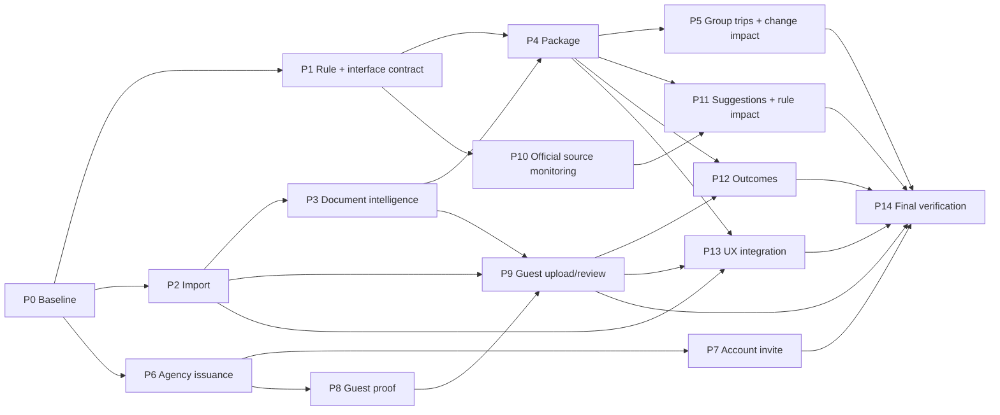

# UMPE dependency graph, exclusive writers, interface gates

## Dependency DAG (not a blanket sequential queue)

Some dependent work can be performed spec-first or module-first while upstream work is unmerged, but must not claim runtime completion until its real interface has landed and been tested.

## Parallelism control

- **One lead/integrator**, who makes cross-lane architecture decisions and controls shared surface merges.
- **One schema writer at a time**, delegated by lead. All Drizzle schema/migration files, migration journal, and exact manifest serializer protocol have a single owner for each revision. Do not reserve migration numbers speculatively across unmerged branches.
- **Two to four concurrent coding worktrees** by default. Scale down when CI/test resources are contended or the next unit depends heavily on an unmerged interface. Read-only research/review agents may run separately.
- Each worker writes new namespaced files in its own lane and existing local UI/tests it explicitly owns. It cannot edit a hot file merely because a quick fix would be convenient. Instead add a small typed adapter, post an exact patch proposal to lead, and schedule the hot-file change in the integrator's branch.
- Single branch: one PR ownership. **No shared worktree**. No self-merge if the repository requires independent review or founder approval. No rebase of another worker's branch without coordination. No force-push to `main`.

## Central hot files: default exclusive owner = lead/integrator

| Hot file / group | Reason | Rule |
|---|---|---|
| `packages/db/src/schema.ts`, `packages/db/migrations/**` | All lanes need tables and additive columns | Schema captain only; no concurrent migrations |
| `packages/services/src/packs.ts` and checksum/pack lifecycle | Immutable historic source truth | Rule lead only, reviewed interface + regression before edits |
| `packages/services/src/missions.ts`, `pack-matching.ts`, `rule-conditions.ts` | Shared route/readiness semantics | Rule/package owner only in assigned merge window |
| `packages/services/src/documents.ts`, `intake.ts`, `profile.ts` | Account ownership, AI provenance, processing | Integration owner approves edits; implement adapters first |
| `packages/services/src/client-invitations.ts`, `agency.ts`, `sharing.ts`, `access/**` | Established authorization and invitation semantics | Agency/security owner only with negative tests |
| `packages/services/src/index.ts`, `packages/core/src/index.ts` | Shared exports create trivial conflicts | Integrator adds exports during merge |
| `apps/web/src/app/app/app-nav.tsx`, `apps/web/src/app/globals.css`, shared layouts | UI parity and design guard conflict | UX integrator only; lane CSS scoped to own components |
| `apps/web/vercel.json`, `.github/workflows/render-cron.yml`, cron auth and render-cron tests | Scheduled jobs must remain exactly in sync | Scheduler integration owner only |
| `packages/services/src/product-events.ts`, notification event union | Closed vocabulary breaks builds if unsynchronized | Analytics/integration owner per approved event map |
| `CLAUDE.md`, `docs/SESSION-START.md`, release state docs | Repo governance and handover | Lead updates only on verified merge |

The coordinator can temporarily delegate a hot file to a worker after recording a lease `(file/group, owner, base SHA, next merge window)`. No other worker edits it until released. A module-specific test file may be freely created in the owner's namespace.

## Suggested owned module namespaces (verify against real repo before use)

- A ingestion: `packages/services/src/umpe-import-*`, `apps/web/src/components/umpe-import-*`, `apps/web/src/lib/umpe-import-*`, component tests. Existing uploader only on integration lease.
- B rule/package: `packages/services/src/umpe-requirements-*`, `umpe-package-*`; rule files on exclusive lease.
- C agency: `packages/services/src/umpe-collection-request-*`, `apps/web/src/app/app/agency/[orgId]/collection/**`; branded invitation only on integration lease.
- D guest: `packages/services/src/umpe-guest-*`, `apps/web/src/app/collection/**`; no unauthorized generic document upload route.
- E source monitoring: `packages/services/src/umpe-source-*`, `scripts/umpe-source/**`, admin review own area; cron edits via integrator.
- F outcomes: `packages/services/src/umpe-outcome-*`, tests and private admin reports; never embed sensitive raw data in product events.
- G UX integration: isolated components until backend contracts pass; existing nav/layout only on lease.

These names are namespacing suggestions, not a mandate to create redundant permanent modules. Prefer existing modules if an extension is both smaller and exclusively owned.

## First interface gate (G0)

Lead verifies: legacy pack checksum test; typed necessity and alternatives; route/context matcher; planned intake batch and guest reference; evidence versions; access/session proofs; single event vocabulary; source-observation and published-rule separation; additive migrations/rollback. Write a short ADR and test vector for each contested irreversible choice. **Only after the cross-lane signatures are stable** can downstream lane code bind to them. Do not block independent ingestion UI or source fetch adapters while verifying unrelated contract details.

## Merge order and unlocked work

- P0, P1 rule contract and compatibility test first.
- In parallel once boundaries stable: P2 import, P6 agency request, P10 source monitoring framework. P3 analysis/fixtures may already be read-only.
- Then P3, P7 and P8; use interfaces and existing adapters rather than editing same services concurrently.
- Then P4 and P9; P11 can follow P10 and P4; P5 follows P4; P12 follows P4 and P9.
- P13 integration is incremental, but primary nav/cross-journey copy finalizes only after real flows exist.
- P14 is end-to-end exact-release gate, not a substitute for PR-by-PR tests.

No requirement is 'done' until its merge SHA, tests and relevant end-to-end behaviour are recorded. If the owner has to activate a provider, mark `CODE-READY / OPS-BLOCKED` without pretending deployment is operational.
